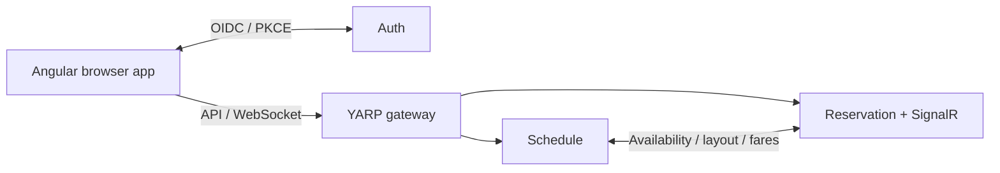

# RailwayLab

A railway ticketing lab built with Angular, ASP.NET Core, OpenIddict, YARP and SQL Server. Passengers can search trains, select seats, sign in, hold seats and confirm a booking. **Checkout simulates payment; no money is charged.**

## System design guide

For the technical interview walkthrough, read [SYSTEM_DESIGN.md](SYSTEM_DESIGN.md): service boundaries, architecture diagram, booking sequence, concurrency guarantees, security and scaling tradeoffs.



In Compose, Nginx serves Angular and proxies API/WebSocket requests to Gateway. Auth is reached directly for browser login and token exchange. Each business service owns its SQL schema; Platform is their shared infrastructure library.

## Implementation status

| Area | Current state |
| --- | --- |
| Platform and Gateway | Shared auth/permissions, health, telemetry, routing and rate limiting implemented |
| Schedule | Stations, trips, layouts, segment pricing and resilient availability implemented; T8 complete |
| Reservation and passenger UI | Holds, policies, simulated checkout, tickets, bookings, expiry and seat updates implemented; T9 complete |
| Authentication | Browser login and PKCE validated; **T7 live refresh rotation/global logout checks remain open** |
| Payment, Analytics/admin and Helpdesk | Separate services and functional operational screens remain planned: T10–T12 |

See [tasks/todo.md](tasks/todo.md) for acceptance evidence. Specifications include future requirements and do not imply those features are built.

## Run locally — apps on the host, SQL Server in Docker

Requires Docker with a running daemon, .NET 10 SDK/runtime and a supported Node.js release (22.22.3+). Configure `.env` once, install web dependencies, then start:

```bash
cp .env.example .env       # Set the passwords and Auth secrets
npm --prefix src/Web ci
./run.sh
```

The script starts only SQL Server and the database initializer through Compose, waits for SQL readiness, then builds and starts Auth, Schedule, Reservation, Gateway and Angular locally. No host SQL Server or sqlcmd installation is required.

Open [localhost:4200](http://localhost:4200). Auth uses `8180`, Gateway `8080`, Schedule `5101`, Reservation `5102`, and Docker SQL Server `1433`. Ctrl-C stops the local apps and leaves SQL running. To stop SQL later:

```bash
docker compose stop sqlserver
```

`./run.sh init-db` starts/initializes only the Docker database. `./run.sh stop` stops the container stack without deleting data; use it before switching from the full-container mode to local apps. If necessary, select .NET 10 with `DOTNET_BIN=/path/to/dotnet ./run.sh`.

The script loads `.env` as data, checks app ports and stops its child processes if a service fails. App startup applies owned EF migrations. Local Auth keys live in ignored `.local-dev/auth-keys`; switching between local and Compose keys invalidates existing sessions. Older pre-migration databases still need explicit upgrade handling.

## Optional Docker Compose

The Compose file and startup script both live in the project root:

```bash
./run.sh docker             # Build/start the whole stack
./run.sh stop               # Stop containers; keep data
# Or use Compose directly:
docker compose up --build -d
```

Compose includes SQL Server and database initialization; Schedule/Reservation have no host ports in this mode. `./run.sh clean` deletes Compose data and app images only after typed confirmation. The SQL Server image uses amd64 emulation on Apple Silicon.

## Verify

```bash
dotnet build RailwayLab.sln
dotnet test RailwayLab.sln
dotnet format RailwayLab.sln --verify-no-changes --no-restore
cd src/Web
npm test -- --watch=false
npm run build
```

SQL integration tests require Docker and use isolated Testcontainers databases, separate from the development SQL volume. Last recorded verification (17 November 2026): **117 .NET tests, 34 Angular tests, builds and formatting passed**, along with real browser booking checks. Authentication remains incomplete until T7 passes.

## Code and documentation

- `src/Services/{Auth,Schedule,Reservation}` — business services and owned migrations.
- `src/{Web,Gateway,Platform}` — passenger app, edge routing and shared infrastructure.
- `tests` — Auth, Platform/Gateway and Schedule/Reservation checks.
- `run.sh`, `docker-compose.yml` — root startup entry points.
- `deploy` — SQL initialization and shared configuration.
- [System design](SYSTEM_DESIGN.md) — concise technical interview guide.
- [Architecture decisions](docs/DECISIONS.md) — service/data boundaries and measured locking tradeoffs.
- [SQL Server study notes](docs/sql-server-notes.md) — optional database internals reference and labs.
- [Task status and follow-ups](tasks/todo.md) — verification evidence and known limitations.
- [Roadmap](tasks/plan.md) · [Target specification](SPEC.md).
