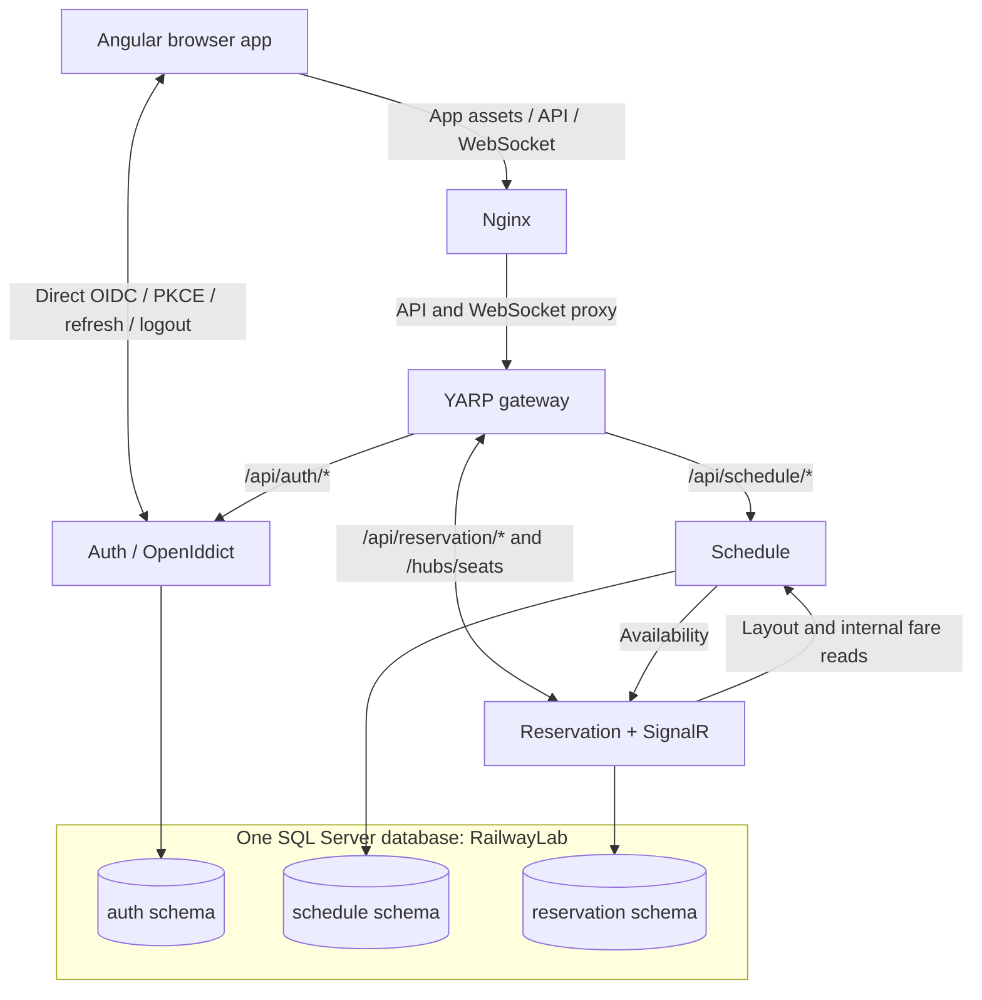
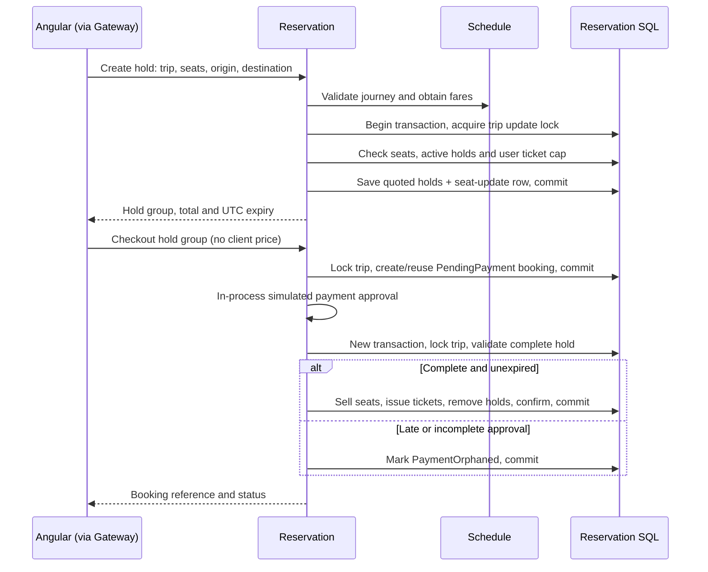

# RailwayLab — system design

A technical interview guide to the implemented system, as verified on 17 November 2026. The core problem is preventing double sales while preserving a usable booking flow when availability, authentication or notifications fail. This is a working lab, not a production-capacity claim.

## Architecture and ownership

| Component | Responsibility / owned data |
| --- | --- |
| Auth | ASP.NET Identity users/roles, OpenIddict clients, authorizations and tokens; signing/encryption keys persist separately |
| Schedule | Stations, routes/stops, trains, dated trips, coaches/seats and segment fares |
| Reservation | Trip inventory, quoted holds, bookings, tickets, policies/audits and seat-update records; payment simulation runs here |
| Gateway | Routes and validates tokens, limits traffic, blocks internal paths; strips Schedule/Reservation API prefixes |
| Platform | Shared library for JWT/permission enforcement, health, logging, tracing and errors; no domain data or runtime service |

Each service has its own SQL login, schema and EF migrations. Cross-service references use public GUIDs; foreign keys stay within a schema. One database reduces lab operations but shares compute and failure risk. Services communicate through HTTP rather than cross-schema queries.

## Critical flow: hold → booking → tickets

Search combines Schedule journeys with Reservation availability. Inventory initializes lazily from Schedule's public layout. Fares come from Schedule using the selected origin, destination and class; the browser never supplies a price.

Checkout and approval are separate transactions. A failure between them can leave a pending booking; retry reuses that booking, while expiry handling settles abandoned holds. The simulation is not an external payment provider or distributed saga.

## Consistency guarantees and tradeoffs

- **Serialize per trip.** Writes acquire `UPDLOCK, HOLDLOCK` on the trip row inside a SQL transaction. This protects multi-seat atomicity and the per-user cap together, at the cost of serializing unrelated seat writes on a busy trip. Interactive writes use a five-second lock timeout; network fare reads happen before the lock.
- **Enforce uniqueness in SQL.** A trip/seat inventory pair is unique, a seat has at most one hold, a hold group has at most one booking, and a seat has at most one ticket. Repeated checkout/approval does not duplicate bookings or tickets.
- **Expire safely.** Expired holds count as available immediately. A 15-second sweeper uses trip locks and `READPAST`; reclaiming seats also expires their pending booking. Holds can extend once, before checkout, and confirmed tickets count toward the user's trip cap.
- **Keep inventory simple.** Seats are sold for an entire trip; segment fares do not imply seat reuse across non-overlapping journey legs. Per-leg inventory would need a different conflict model.

The [locking experiment](docs/DECISIONS.md#adr-3-reservation-locking) produced one winner and 49 conflicts for both update locking and rowversion. Its single-row, single-pair timing does not establish production throughput or justify replacing the multi-seat locking design.

## Authentication and trust boundaries

The SPA uses authorization code with S256 PKCE and browser session storage. Auth owns discovery, JWKS, login, token exchange, refresh rotation and logout. Gateway and business services independently validate issuer, audience, signature and lifetime; services enforce permissions and booking ownership.

Compose services fetch metadata through internal Auth addresses while validating the public issuer `http://localhost:8180/`. Auth checks revocation records locally; other services can accept issued JWTs until their five-minute lifetime plus clock skew expires. **T7 live refresh/global logout acceptance remains open.** The internal fare endpoint is anonymous on the service network and blocked at Gateway; network placement is its current protection.

## Failure handling and live updates

| Condition | Implemented response / limit |
| --- | --- |
| Availability unavailable | Schedule retries once, uses a circuit breaker and 75 ms per-attempt timeout, then returns **unknown**, not zero seats |
| Competing seat request | Trip lock serializes the decision; the loser receives a conflict rather than a partial hold |
| Notification delivery | State and `SeatUpdates` rows commit together; each instance polls every 250 ms and batches SignalR broadcasts; clients refetch authoritative status |
| Reader/broadcast outage | Five-minute creation-time read window, ten-minute retention and unbounded local buffering make delivery best effort; reconnect refetches state |
| Diagnostics | Serilog, trace IDs, HTTP/SQL OpenTelemetry instrumentation, liveness and DB-readiness endpoints; OTLP export requires collector configuration |

Public SignalR groups carry seat changes; authenticated private groups derive their user ID from the token. The SQL stream supports independent readers, but Compose currently runs one Reservation instance. Tested Wolverine helpers exist in Platform; running services do not register them, and Compose has no RabbitMQ broker.

## Evidence and next steps

The last recorded run passed **117 .NET and 34 Angular tests**, builds and formatting. SQL tests cover competing holds, overlapping selections, expiry, ticket idempotency, ownership, migrations and independent readers. Real browser checks cover PKCE login through simulated checkout; a second anonymous browser observed a hold in 383 ms in one run, not a latency guarantee.

T10 Payment is next, followed by Analytics/admin and Helpdesk (T11–T12); resume deferred T7 live authentication acceptance separately. Before production use, add durable notification recovery/backpressure, paginated booking reads, trusted-proxy-aware rate limits and representative load tests. See [task follow-ups](tasks/todo.md#follow-ups) for remaining work.
