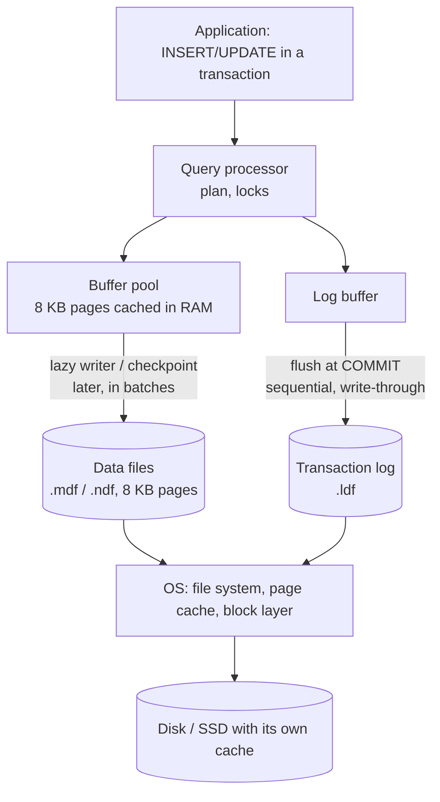
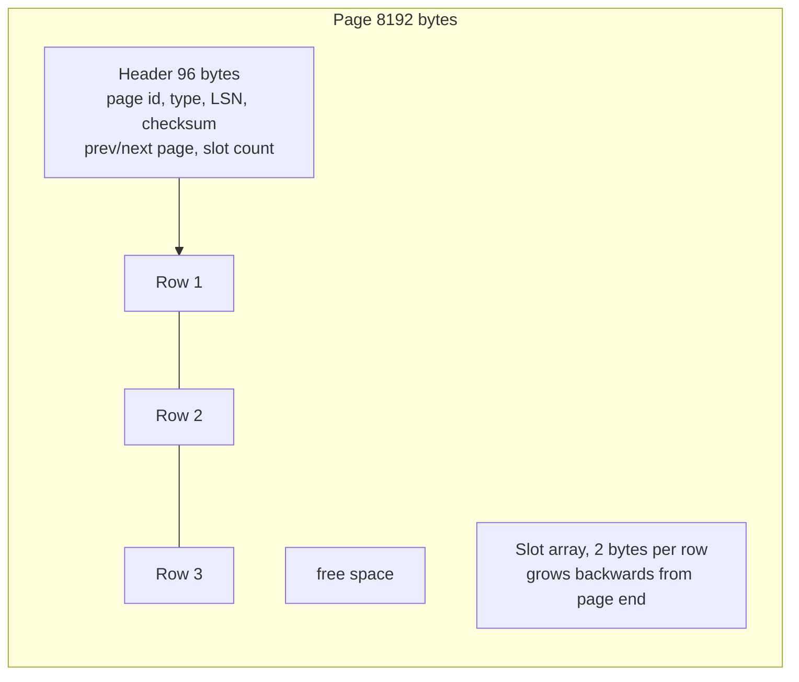
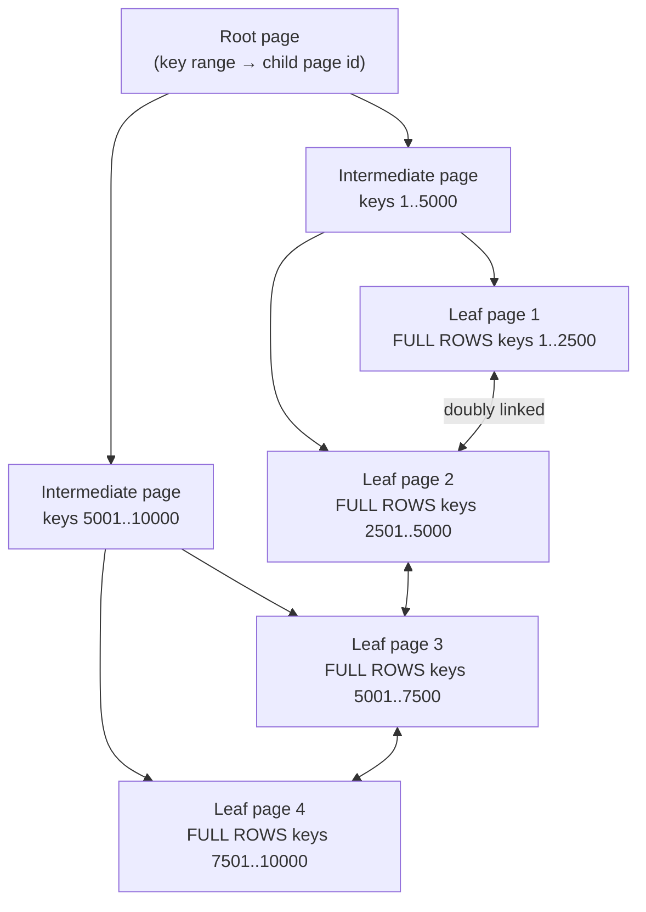
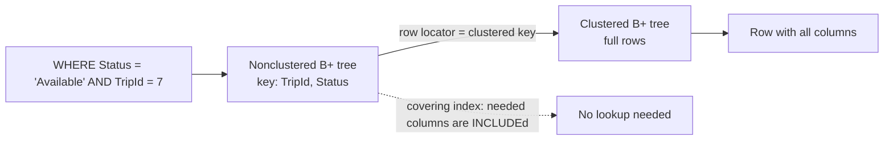
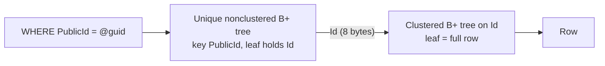
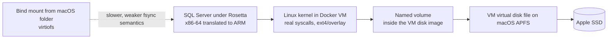
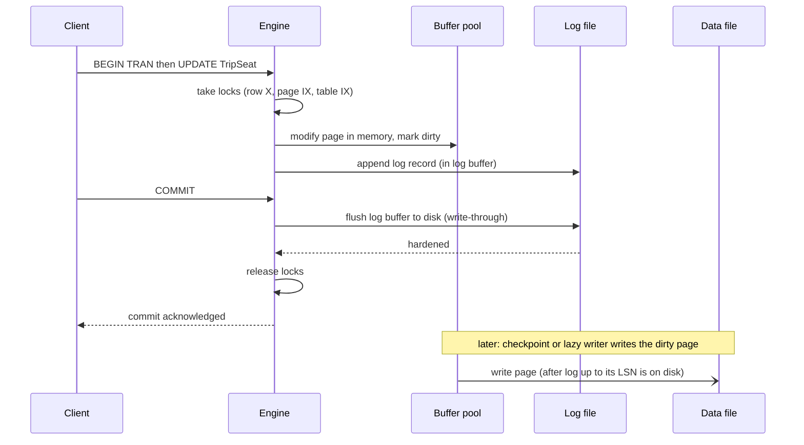
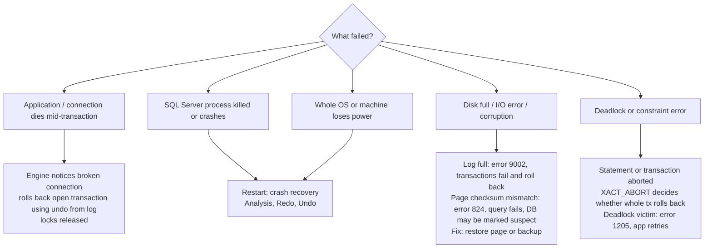

# SQL Server study notes

Reference material and optional labs for SQL Server 2025 on Linux/Apple Silicon Docker. These are study notes, not evidence of implemented features or completed experiments. Items marked **(verify)** need confirmation from primary documentation before use in an interview. Undocumented commands are for disposable learning databases only.

For the project's actual architecture and decisions, use [SYSTEM_DESIGN.md](../SYSTEM_DESIGN.md) and [DECISIONS.md](DECISIONS.md).

## B1. The big picture



Core idea: **the log is the source of truth at commit time; data pages are written lazily.** A commit is acknowledged only after its log records are safely on stable storage. Data pages in memory (dirty pages) can reach disk before or after the commit, and recovery fixes either case using the log.

## B2. Files, pages and extents

| Unit | Size | Notes |
|---|---|---|
| Page | 8 KB (8192 bytes) | The unit of I/O and caching. 96-byte header, then rows, then a slot array at the end of the page |
| Extent | 8 pages = 64 KB | Unit of space allocation. Uniform extents (one object) are the default for user databases since SQL Server 2016; older "mixed extents" shared small objects |
| Data file (`.mdf`, `.ndf`) | many extents | Belongs to a filegroup. A page id is `file_id:page_number`, for example `(1:312)` |
| Log file (`.ldf`) | circular sequence of VLFs | Written sequentially, never read in normal operation |



- Max in-row record size is **8060 bytes**. Larger variable-length data moves off-row (below).
- **Slot array:** each row has a 2-byte offset at the end of the page. Rows can be reorganized inside the page without changing their slot number (this is why an index can point to `page:slot`).
- **Allocation bookkeeping pages:** GAM (which extents are free), SGAM (mixed extents with free pages), PFS (per-page free-space and state), IAM (which extents belong to one allocation unit). The first pages of each file hold these, plus the file header and boot page.
- **Allocation units** per table/index partition: `IN_ROW_DATA`, `LOB_DATA` (large values), `ROW_OVERFLOW_DATA` (rows that overflowed 8060 bytes).
- **Checksum:** with `PAGE_VERIFY CHECKSUM` (default), a checksum is written into the header when the page leaves the buffer pool and verified when it's read back.

## B3. How a row is stored, and how each data type looks on disk

Classic row layout (FixedVar record), roughly:

```
[status bits 2B][offset to null bitmap 2B][fixed-length columns...]
[column count 2B][NULL bitmap][variable column count 2B][variable offsets 2B each][variable data...]
```

- **Fixed-length columns first** (in column order), then **variable-length columns** at the end, located through an offset array. Reading a variable column means following its offset.
- **NULL** is not stored as a value: a bit in the NULL bitmap marks it. A NULL in a fixed-length column still reserves its space (a NULL `int` still takes 4 bytes); a NULL variable-length column takes no data bytes.
- Integers are stored **little-endian** two's complement. Index ordering is done by the engine comparing *typed values*, not by byte-wise comparison of the raw bytes.

| Type | Storage | Things worth knowing |
|---|---|---|
| `tinyint`/`smallint`/`int`/`bigint` | 1/2/4/8 bytes | Little-endian, signed (except tinyint). `bigint IDENTITY` is monotonically increasing so inserts append to the right edge of a B+ tree |
| `bit` | packed, up to 8 bits per byte | Several `bit` columns share a byte |
| `decimal(p,s)` | 5, 9, 13 or 17 bytes by precision | Stored as a scaled integer plus sign; exact |
| `float`/`real` | 8/4 bytes | IEEE 754 binary floating point; inexact (never use for money) |
| `money` | 8 bytes | Scaled integer (4 decimal places) |
| `date`/`datetime2` | 3 / 6 to 8 bytes | `datetime2` precision decides size; `datetime` is 8 bytes with 3.33 ms rounding |
| `char(n)` / `varchar(n)` | n bytes / actual length + 2 | Single-byte or multibyte code page defined by the **collation**; UTF-8 collations exist since SQL Server 2019 |
| `nchar` / `nvarchar` | 2 bytes per character (UTF-16) | Characters outside the BMP use 4 bytes (surrogate pairs). Twice the size of `varchar` for ASCII text, so index keys are wider |
| `varchar(max)`, `nvarchar(max)`, `varbinary(max)`, `xml` | in-row up to a limit, otherwise **LOB_DATA** | Off-row values are stored in a separate allocation unit as a tree of pages; the row holds a pointer. Reading them costs extra page reads |
| `uniqueidentifier` | 16 bytes | **Compared in an unusual byte order** (the last 6 bytes are the most significant, then bytes 8-9, 6-7, 4-5, 0-3). That is why random GUIDs fragment a clustered index and why `NEWSEQUENTIALID()` / the EF Core sequential generator exist |
| `rowversion` / `timestamp` | 8 bytes | A database-wide increasing counter, bumped on each row modification; used for optimistic concurrency |
| `vector` (SQL Server 2025) | binary payload plus small header | Stored as a binary blob with a type header; comparisons by distance functions, not by B+ tree order **(verify exact storage and index support in current docs)** |

Collation affects comparison, sort and index order of string columns: a case-insensitive, accent-sensitive collation makes `'a' = 'A'` true, and the index stores the original text but orders it by the collation's sort key. Trailing spaces are ignored in `=` comparisons for `char`/`varchar` (ANSI padding rules). A wider key (long `nvarchar`) means fewer entries per index page, a taller B+ tree and more I/O.

**Off-row and overflow:** if a row's variable-length data would push it past 8060 bytes, SQL Server moves the largest variable-length columns to `ROW_OVERFLOW_DATA` (leaving a 24-byte pointer). Wide rows reduce rows per page, which reduces cache efficiency.

## B4. Heaps and clustered indexes (B+ tree)

A table is either a **heap** (no clustered index: unordered pages found through IAM pages) or a **clustered index** (the table *is* a B+ tree ordered by the clustering key).



- **Leaf level of a clustered index = the actual data pages.** Rows are logically ordered by the key; leaf pages are linked in a doubly linked list so range scans read forward/backward without touching upper levels.
- **Non-leaf pages** hold `(lowest key of child, child page id)` pairs. A seek walks root → intermediate → leaf; with 8 KB pages and narrow keys the tree is typically 3-4 levels even for millions of rows, so a seek is about 3-4 page reads.
- **Logical order vs physical order:** pages are linked in key order, but their positions in the file can be scattered. Scattering is **fragmentation**; it hurts read-ahead and range scans (less on SSDs).
- **Non-unique clustered key:** SQL Server adds a hidden 4-byte *uniqueifier* to duplicate keys so every row is uniquely addressable.

### Page splits (why key choice matters)

When an insert targets a full page, SQL Server allocates a new page, moves about half the rows to it, relinks neighbours and updates the parent: it's logged (extra log volume), can cascade upward, and leaves both pages about half full and the new page possibly out of physical order.

| Clustering key | Insert pattern | Result |
|---|---|---|
| `bigint IDENTITY` (increasing) | always the right-most leaf | No mid-tree splits, pages ~100% full, minimal fragmentation. At very high concurrency the right-most page becomes a hot spot (`PAGELATCH_EX` waits); `OPTIMIZE_FOR_SEQUENTIAL_KEY` (2019+) mitigates this |
| Random GUID | random leaf each time | Constant page splits, ~70% average fill, heavy fragmentation, more log, bigger buffer pool footprint |
| Sequential GUID | mostly right-most | Like identity, but 16 bytes wide in every nonclustered index |

`FILLFACTOR` leaves free space on pages at index build time to delay splits when inserts hit the middle of the tree (trade-off: bigger index, more pages to read).

## B5. Nonclustered indexes

A nonclustered index is a **separate B+ tree**. Its leaf rows contain:

```
[index key columns] + [row locator] + [INCLUDE columns]
row locator = the clustering key (if the table has a clustered index)
            = RID file:page:slot (if the table is a heap)
```



- **Key lookup (bookmark lookup):** if the query needs columns not in the nonclustered index, the engine seeks the clustered index once per row found. 10 rows = 10 extra seeks; 100,000 rows can be worse than just scanning, so the optimizer switches strategy based on estimated rows (the "tipping point").
- **The clustering key is copied into every nonclustered index.** A wide clustering key (a 16-byte GUID or long string) makes all other indexes bigger. This is the main reason I chose `bigint` for the clustered key (see ADR 2 in DECISIONS.md).
- `INCLUDE` columns are stored only at the leaf, not in the search path, so they don't widen non-leaf pages.
- **Filtered index:** an index over a subset of rows (`WHERE Status = 'Held'`): smaller and cheaper to maintain, ideal for the sweeper scanning expired holds.
- **Unique indexes** are enforced by the same B+ tree: an insert first *seeks* its key, and a duplicate is found on the target leaf page. That is why the `UNIQUE(TripSeatId)` constraint is a reliable last line of defense for the double-booking rule.
- **Write cost:** every insert/update/delete touches the clustered index and every nonclustered index that includes an affected column. More indexes = slower writes, more log, more memory.
### Worked example: why my `PublicId` lookup takes two seeks (and why I still chose it)



- Seek 1: root → leaf of the `PublicId` index (3 to 4 pages). The leaf row is `(PublicId, Id)`; the clustering key is stored there automatically, so there is no extra lookup to find `Id`.
- Seek 2: root → leaf of the clustered index by `Id` (3 to 4 pages) to get the full row.
- Compared with a GUID clustered key, which needs one seek, the hybrid costs about 3 to 4 more page reads per public lookup (mostly cached upper levels).
- What it buys: inserts append to the right edge (no random page splits), every other nonclustered index carries an 8-byte locator instead of 16, and joins, FKs, locks and sweeper scans use the narrow key. Writes pay for one extra index (`PublicId`), and that insert is random in the GUID index, but that index is narrow (16 + 8 bytes per row) compared with the whole table.
- Batch trick: resolve many public ids at once with `WHERE PublicId IN (...)` and work with `Id`s afterwards.
- The honest alternative is a sequential GUID clustered key (one seek, simpler). The tuning module measures both and ADR 2 records the result.

- **Columnstore** (not used here) stores data by column in compressed segments for analytics; rowstore B+ trees are right for OLTP seat claims.

## B6. The buffer pool and the OS

SQL Server does **not** use the OS page cache as its primary cache. It manages its own **buffer pool** of 8 KB buffers (part of SQLOS), with its own replacement algorithm, read-ahead and background writers.

- **Read:** the engine looks for the page in the buffer pool. On a miss, it issues an I/O to the data file (a *physical read*), often with read-ahead for scans. A hit is a *logical read*. (`SET STATISTICS IO ON` shows both.)
- **Write:** an update changes the page *in memory* and marks it dirty. A **checkpoint** (automatic, target recovery time 60 s by default) and the **lazy writer** (under memory pressure) write dirty pages to the data file later, in batches, with mostly random I/O.
- **Log:** a commit forces the log buffer to disk: sequential, small, latency-critical. This is the `WRITELOG` wait you see on busy systems.
- **Why bypass the OS cache for writes:** a normal `write()` only reaches the OS page cache; data is lost on power failure until `fsync`. SQL Server asks the OS for write-through semantics so that "hardened" means on stable media. On Windows this is `FILE_FLAG_WRITE_THROUGH` and unbuffered I/O; on Linux, SQL Server runs on a platform abstraction layer (SQLPAL) that maps these requests to Linux I/O using direct I/O and sync flags (`O_DIRECT`, `O_DSYNC`-style behaviour) and relies on filesystem and kernel support for flush/FUA **(verify the exact mechanism and the kernel/filesystem requirements in the "SQL Server on Linux" storage docs)**.
- **Layers that can lie:** the OS page cache, the hypervisor, the disk's volatile write cache. A disk without power-loss protection may acknowledge a write that is still in its RAM. Enterprise SSDs and RAID controllers with battery/capacitor backup exist for this reason.

### What this means for my Docker setup on the Mac



- Rosetta translates only user-space CPU instructions; file I/O is real Linux syscalls into the VM's kernel.
- Use a **named volume** for `/var/opt/mssql`, not a bind mount of a macOS folder (slower; filesystem behaviour differs).
- Durability across a Mac power cut is only as strong as the VM disk's flush behaviour; fine for a demo, worth mentioning as a limitation.
- `docker stop` sends SIGTERM and waits (10 s default) before SIGKILL: give SQL Server a longer `stop_grace_period` (for example 60 s) so it can checkpoint and shut down cleanly. SIGKILL (`docker kill`) behaves like a crash: the next start runs crash recovery.

## B7. Transactions, write-ahead logging and durability

**Write-ahead logging (WAL) rule:** a log record describing a change must be on stable storage **before** the changed data page is written; and all of a transaction's log records must be on stable storage **before** the commit is acknowledged.

- Every change generates log records with increasing **LSN** (log sequence number): operation, transaction id, page id, *before and after* information (enough to redo or undo).
- Each data page header stores the LSN of the last log record that modified it (`pageLSN`). Before the lazy writer writes a dirty page, the log must be flushed up to that LSN.
- **Steal / no-force:** uncommitted changes *may* reach the data file (steal), and committed changes *need not* be in the data file at commit (no-force). That gives good performance, and the log makes it safe. This is the ARIES model.
- **Group commit:** many concurrent commits share one log flush. Log flush latency (`WRITELOG`) is usually the throughput ceiling for small transactions.



### Locks, latches, isolation (short version)

- **Locks** protect logical data for transaction duration: shared (S), exclusive (X), update (U), intent (IS/IX), and key-range locks under SERIALIZABLE. Lock escalation to table level happens around 5,000 locks per statement. A seat claim takes a row (key) lock on the target row.
- **Latches** are short-term in-memory locks protecting page structures during reads/writes (for example, the `PAGELATCH` hot spot on the right-most leaf).
- **Row versioning** (`READ_COMMITTED_SNAPSHOT`, `SNAPSHOT`): readers see the last committed version instead of blocking; versions live in the tempdb version store, or in the persistent version store (PVS) in the user database when Accelerated Database Recovery is on.
- Deadlocks: the engine picks a victim (error 1205), rolls it back, and the app must retry. Consistent lock ordering (sorted seat ids in my Reservation module) prevents most.

## B8. When something fails: what the database and the OS do



### Crash recovery in detail (after SIGKILL, power loss, kernel panic)

1. **Analysis:** read from the last checkpoint forward; work out which transactions were active and which pages might be dirty.
2. **Redo:** replay log records forward for every change whose LSN is newer than the page's `pageLSN`, *including changes from transactions that never committed*. This repeats history so the data files match the exact moment of the crash.
3. **Undo:** roll back every transaction that had no commit record, using the logged before-images. Undo writes *compensation log records* (CLRs), so a crash during recovery is itself recoverable.

Result: all committed transactions are present (durability), no uncommitted changes remain (atomicity). The database is `In recovery` until redo completes; the error log prints progress ("Recovery of database ... is x% complete", "n transactions rolled back"). Enterprise-class engines can let users in after redo while undo continues in the background.

### Scenario table

| Scenario | What happens | Outcome |
|---|---|---|
| App crashes or kills connection after `BEGIN`, before `COMMIT` | Server sees the session end and rolls back using the log | No partial data; locks freed |
| `COMMIT` sent, server crashes before log flush finished | Commit record not on disk | Transaction is rolled back at recovery; the client never got an acknowledgment |
| `COMMIT` hardened, then server crashes before the data page was written | Log has the change, data file does not | Redo reapplies it at startup |
| Crash after the client sent COMMIT; log hardened; **network drops before the ack** | The commit *did* happen but the client doesn't know | **Unknown outcome** (the same class of problem as a payment timeout). Handle with idempotency keys and a lookup of the outcome, never a blind retry |
| Dirty uncommitted page was written to the data file, then crash | "Steal" case | Undo removes the change at recovery |
| Torn page: only part of an 8 KB page reaches disk (the disk writes 512 B/4 KB sectors) | Checksum mismatch on next read: error 824 | Recovery cannot repair a torn page (redo relies on a valid page LSN). Restore the page or database from backup. SQL Server has no doublewrite buffer (InnoDB does; PostgreSQL logs full-page images after checkpoints for this reason) |
| Transaction log disk full | Error 9002: new writes fail; the failing transaction rolls back | Free space or extend the log; in my demo, mount a volume with room and size the log sensibly |
| Disk lies about flush (volatile cache, VM) | WAL guarantee silently broken | Possible lost commits or corruption; the reason production uses power-loss-protected storage |
| Deadlock | Victim chosen (error 1205), rolled back | App retries with backoff |
| `XACT_ABORT OFF` and a runtime error mid-batch | Only the failing statement is rolled back; the transaction stays open | Use `SET XACT_ABORT ON` and `TRY/CATCH` so errors abort the whole transaction |
| Long-running rollback | Undo repeats the work in reverse and takes about as long as the original work | Don't kill big transactions casually; keep transactions short |

## B9. How this connects to RailwayLab

- Reservation takes a trip-row update lock before evaluating seats and the user cap; it then updates tracked entities inside the transaction. It does not currently rely on a conditional seat UPDATE or rowversion retry loop.
- Unique hold and ticket indexes provide database-level protection against duplicate claims/issuance.
- Internal relational keys and public GUID indexes serve different lookup and ownership roles; see [ADR 2](DECISIONS.md#adr-2-data-ownership-and-identifiers).
- State and seat-update records commit together, but polling/broadcast delivery is best effort. A durable broker outbox remains a future payment-integration concern.
- SQL durability depends on database/storage configuration; a passing concurrency test does not establish crash-recovery or backup guarantees.

## B10. Hands-on labs (run on my SQL Server container)

Use disposable databases for these optional labs and record actual observations separately.

1. **Look inside a page.** Create a small table (int, nvarchar, NULLs), insert rows, then use `sys.dm_db_database_page_allocations` (or `DBCC IND`) to find its pages and `DBCC TRACEON(3604); DBCC PAGE('<db>', 1, <page>, 3)` to print the page. Find: header, LSN, slot array, the NULL bitmap, the variable-column offsets, the little-endian int bytes.
2. **Row sizes by type.** Insert the same value as `int`, `bigint`, `decimal(18,2)`, `varchar`, `nvarchar`, `uniqueidentifier`; compare `DATALENGTH()` and page count in `sys.dm_db_index_physical_stats`.
3. **Fragmentation experiment.** Create two tables with 500k rows: clustered on `bigint IDENTITY` vs on a random `NEWID()`. Compare `avg_fragmentation_in_percent`, `avg_page_space_used_in_percent`, page count and log size. Repeat with `NEWSEQUENTIALID()` / EF Core sequential GUID.
4. **Index structure and key lookup.** Build a clustered and a nonclustered index; show the plan with a key lookup, then add `INCLUDE` to remove it. Inspect `index_depth` in `sys.dm_db_index_physical_stats` and the page count of each level.
5. **Watch the log.** `BEGIN TRAN; UPDATE ...;` then query `sys.dm_tran_database_transactions` (log bytes used) and `fn_dblog` (undocumented) to see the log records, and note the LSN. Commit and watch `WRITELOG` in `sys.dm_os_wait_stats`.
6. **Crash recovery drill.** In one session `BEGIN TRAN; INSERT ...` (uncommitted); in another, commit a separate row; then `docker kill <container>`, restart, and read the SQL error log: confirm the committed row exists, the uncommitted one is gone, and note the recovery messages. Repeat with `docker stop` to compare (clean shutdown, no recovery work).
7. **Page splits.** Insert into the middle of a full clustered index and count `Page Splits/sec` (`sys.dm_os_performance_counters`) before/after; try a lower `FILLFACTOR`.
8. **Locks.** `BEGIN TRAN; UPDATE ...` without commit, then look at `sys.dm_tran_locks` from another session; try `READPAST` and `UPDLOCK`, and cause and read a deadlock (extended event or error 1205).

## B11. Other engines (comparison reference)

| Topic | SQL Server | PostgreSQL | MySQL InnoDB |
|---|---|---|---|
| Table storage | Heap or clustered B+ tree | Always a heap; indexes point to row ids (`ctid`) | Clustered B+ tree on primary key |
| Secondary index points to | Clustering key (or RID) | Heap tuple id | Primary key |
| MVCC | Optional row versioning (tempdb / PVS); default uses locks | Old row versions stay in the heap; `VACUUM` reclaims them | Undo log holds old versions |
| Torn page protection | Page checksum, restore from backup | Full-page writes in WAL after checkpoint | Doublewrite buffer |
| Large values | LOB allocation unit | TOAST tables | Off-page BLOBs |
| WAL | Transaction log, ARIES-style | WAL, similar redo-based recovery | Redo log + undo log |

## B12. Review questions

1. What is a page and an extent, and how big are they? What is on a page?
2. How is a row laid out? Where do NULLs, variable-length columns and large values go?
3. Why is `int` 4 bytes on disk but comparison isn't memcmp? How does collation change index order?
4. Why does a random GUID clustered key fragment, and what do sequential keys cost at high concurrency?
5. Draw a clustered B+ tree. How many page reads for a seek on 3 million rows?
6. What does a nonclustered index leaf contain? What is a key lookup and when does the optimizer avoid it?
7. Why does a wide clustering key hurt every other index?
8. What is write-ahead logging, and why is commit latency tied to the log, not the data file?
9. What are steal and no-force? Why does redo also replay uncommitted work?
10. Walk through crash recovery (analysis, redo, undo). What does the database look like during recovery?
11. A transaction is half done when the process is killed. What state is the data in after restart?
12. The client sent COMMIT and the connection dropped. Did it commit? How do I design for that?
13. What is a torn page? How do SQL Server, PostgreSQL and InnoDB each defend against it?
14. What does `fsync` guarantee, and where can durability still be lost (VM, disk cache)?
15. Why does SQL Server use its own buffer pool and bypass the OS cache for writes?
16. Locks vs latches vs isolation levels vs row versioning: what protects what?
17. Why use a named Docker volume and graceful database shutdown?
18. Why is the unique index a trustworthy last line of defense for "a seat is sold once"?
