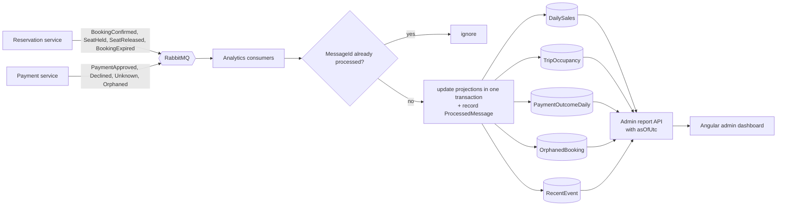
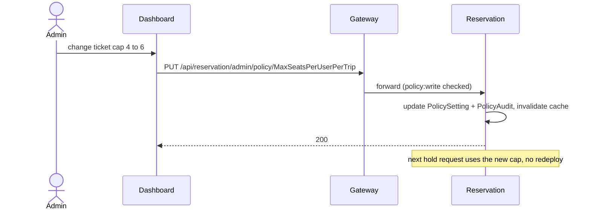
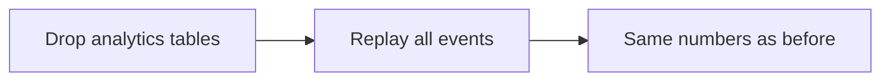

# SPEC-analytics

Depends on: payment.

Planned under T11; required in the target scope. Current admin pages do not provide reports or operational controls.

## Objective
CQRS read side: event-driven projections and an admin dashboard so the admin can see sales, occupancy, payment health and the orphaned-payment queue, and edit policy.

## Data model (schema `analytics`)
- Ids from events are `PublicId`s only (see the id strategy in SPEC.md); read-model rows are keyed by them or by natural keys.
- `ProcessedMessage(MessageId PK, ProcessedAtUtc)` for idempotent handling.
- `DailySales(Date, RouteName, ClassCode, Bookings, Tickets, Revenue)`.
- `TripOccupancy(TripPublicId, TrainName, ServiceDate, TotalSeats, HeldSeats, SoldSeats, UpdatedAtUtc)`.
- `PaymentOutcomeDaily(Date, Approved, Declined, Unknown, Orphaned)`.
- `OrphanedBooking(BookingPublicId, UserId, Amount, DetectedAtUtc, Status)`.
- `RecentEvent(Id bigint, Type, Summary, OccurredAtUtc)` (last 200, used as activity feed).

## Behavior
Consumes `BookingConfirmed`, `SeatHeld`/`SeatReleased`, `PaymentApproved/Declined/Unknown`, `BookingPaymentOrphaned`, `BookingExpired`. Handlers are idempotent and tolerate out-of-order delivery (events carry version/timestamp). A rebuild command replays from scratch (dev tool) to prove projections are derived.

## API (`reports:read`)
`GET /admin/reports/sales?from=&to=`, `/occupancy?date=`, `/payments/summary?from=&to=`, `/orphaned`, `/activity`. Responses include `asOfUtc`.

## UI (Angular `/admin`, lazy, `reports:read` guard)
Dashboard: KPI cards (revenue, tickets, occupancy %, payment success rate), sales chart (Chart.js) by day/route, occupancy table per trip, orphaned payments list, recent activity feed, and the policy editor (reads/writes Booking admin policy API through the gateway; shows audit trail).

## Acceptance criteria
1. After a booking and a payment, dashboard numbers update within a few seconds and match a direct SQL count in a test.
2. Replaying the same event 5 times changes nothing (idempotency).
3. Out-of-order events do not corrupt occupancy counts.
4. Deleting analytics tables and running the rebuild reproduces identical numbers.
5. Passenger token gets 403 on every report endpoint; `operations` gets 200 on reports and the orphaned list but the policy editor is read-only for them (`policy:write` needed to save); the UI route is guarded and the API independently enforces it.
6. Editing the ticket cap in the dashboard changes Reservation behavior without redeploy and appears in the audit list.
7. Every dashboard figure displays the "as of" time.

## Testing
Projection unit tests, integration tests with RabbitMQ and SQL Server, one Playwright admin smoke test.

## Boundaries
Never: query Reservation/Payment tables; reports must come from events only.

## Diagrams

### Event flow into read models

### Policy editing crosses services through the API, not the database

### Rebuild proves projections are derived

