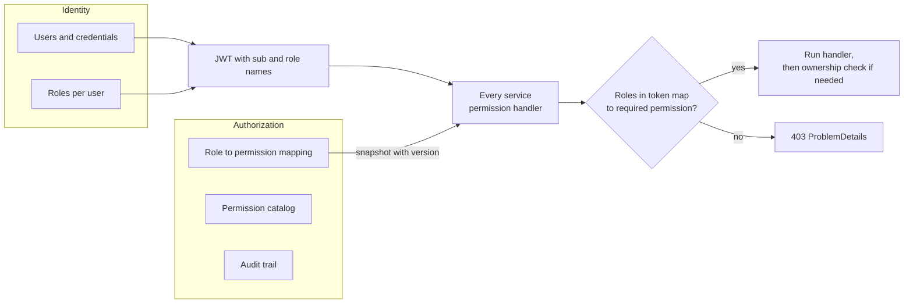
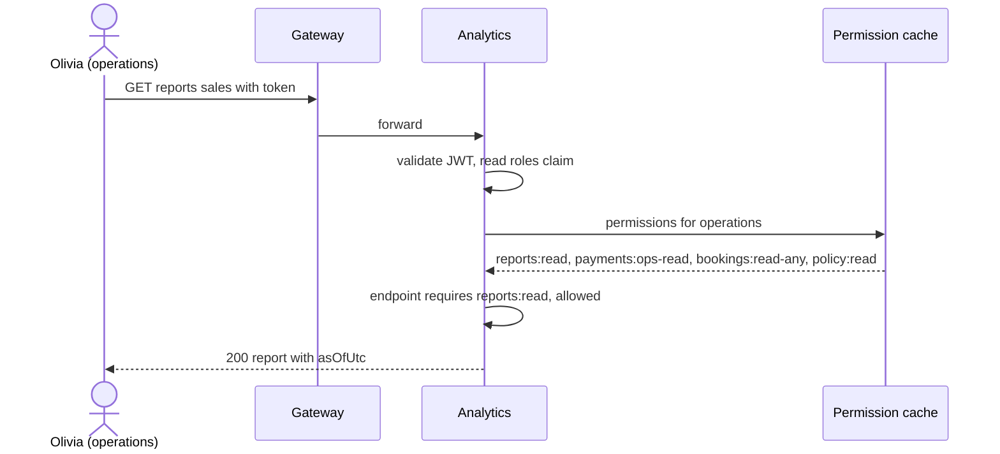
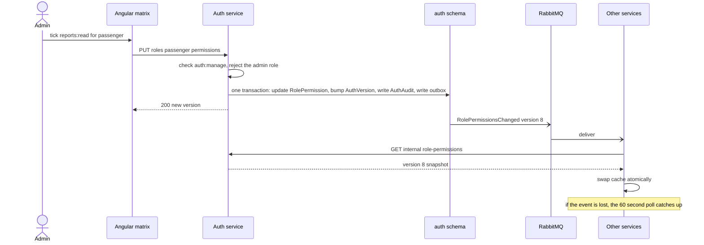
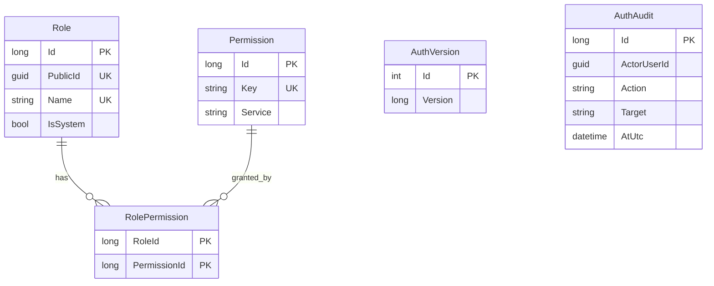
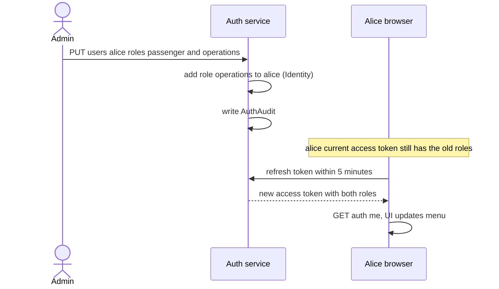

# SPEC-auth

Depends on: platform (Compose, Platform project). Consumed by every other module.

OpenIddict and local permission enforcement are implemented; T6 passed and T7 live acceptance remains open. Editable mappings, remote snapshots and management UI below remain planned.

## Objective
One module that owns everything about who a caller is and what they may do: the OIDC identity provider setup, token and JWT validation rules, role-based access control (RBAC) with fine-grained permissions, an admin UI to manage roles, permissions and user role assignment, and an audit trail. Learning focus: OAuth2 and OpenID Connect, JWT, authentication vs authorization, permission-based policies, cache invalidation across services, privilege-escalation and lockout safety.

## Concepts (keep these straight for the interview)
- **Authentication** (who are you): OIDC, JWT, and the custom Auth service.
- **Authorization** (what may you do): permissions, checked in each service.
- **Role** = a named bundle of permissions (`station-agent`). **Permission** = one capability (`seats:hold`). Code checks permissions, never role names, so roles can change without redeploying.
- **Source of truth split:** the Auth service owns the identity contract, credential flow, and role-to-permission mapping; each service still checks permission requirements locally so authorization remains explicit and cacheable.

## Foundation and planned management

| Part | What | Status |
|---|---|---|
| A. Identity foundation | custom OIDC/Auth service identity flow, seeded users, JWT validation, permission infrastructure with a static seed mapping | Implemented; T7 acceptance open |
| B. Auth service and UI | Mapping and assignment management, snapshot propagation, audit, `/admin/auth` UI | Planned |

Part A means every module is protected by permissions from day one; part B is the management layer on top.

## Part A: Identity foundation

- Custom OIDC/Auth service configuration for the project identity flow:
  - Public client `web` (Authorization Code + PKCE, no secret, exact redirect URIs).
  - Confidential client `internal-services` (client credentials; role `service`): used for service-to-service calls such as the permission snapshot fetch.
  - Roles: `passenger`, `station-agent`, `operations`, `admin`, `service`.
  - Seeded users: `alice`, `bob` (passenger), `sam` (station-agent), `olivia` (operations), `admin` (admin).
  - Access token lifetime 5 min, refresh token rotation with reuse leeway (14-day lifetime), account lockout on repeated failures, audience `railway-api` so tokens are meant for the API. Security-stamp validation interval is zero so "sign out everywhere" applies immediately.
- JWT validation in `src/Platform` (technical only): discovery and JWKS from the Auth service, validate signature, `iss`, `aud`, `exp`, small clock skew; map role claims to permission sets; `sub` is the `UserId`.
- Permission infrastructure in `src/Platform`:
  - `RequirePermission("seats:hold")` endpoint extension and a `PermissionAuthorizationHandler` (replaces the earlier `Passenger`/`Admin` policies).
  - `IPermissionSource` with `StaticPermissionSource` (reads `deploy/auth/default-role-permissions.json`, current implementation and tests) and, in part B, `RemotePermissionSource`.
  - Extended default-deny test: every endpoint declares `AllowAnonymous` (on the reviewed allowlist, GET-only) or a permission; every permission used in code exists in the catalog and in the seed mapping; `admin` holds all of them.
- The Auth service is built on ASP.NET Identity + OpenIddict (no external IdP; Keycloak may be reintroduced later).

## Roles and permissions

Permission catalog (declared in code next to the endpoint that needs it; the table in the Auth service is a mirror for the UI):

| Permission | Service | Meaning |
|---|---|---|
| `seats:hold` | reservation | hold, extend, release own seats |
| `bookings:read-own` | reservation | read own bookings and tickets |
| `bookings:read-any` | reservation | read any booking (support, agents) |
| `bookings:create-on-behalf` | reservation | hold and book for a walk-in passenger |
| `policy:read` | reservation | read policy settings |
| `policy:write` | reservation | change policy settings |
| `payments:pay` | payment | pay for own booking |
| `payments:ops-read` | payment | orphaned and unknown payment queues |
| `reports:read` | analytics | dashboard and reports |
| `helpdesk:chat` | helpdesk | use the assistant |
| `auth:read` | auth | view roles, mapping, users, audit |
| `auth:manage` | auth | change mapping, assign roles |

Seeded mapping (editable in the UI except `admin`):

| Role | Permissions |
|---|---|
| `passenger` | `seats:hold`, `bookings:read-own`, `payments:pay`, `helpdesk:chat` |
| `station-agent` | everything `passenger` has, plus `bookings:create-on-behalf`, `bookings:read-any` |
| `operations` | `reports:read`, `payments:ops-read`, `bookings:read-any`, `policy:read` |
| `admin` | every permission (system role, cannot be edited) |

The `service` role is for machine-to-machine calls only and is not in the mapping table (it grants the internal endpoint, nothing else). Public (anonymous) endpoints need no permission and stay on the reviewed allowlist. A user may have several roles; effective permissions are the union.

## Part B: Auth service and UI (planned)

- New service `src/Services/Auth` (own schema `auth`, own SQL login, endpoint → bus → handler layering for the planned management work).
- Auth-management REST calls happen only here, using the dedicated service-account flow.
- Internal endpoint `GET /internal/auth/role-permissions` returning `{ version, roles: { name: [permissions] } }`. Not routed by the gateway; requires a client-credentials token with the `service` role.
- Event `RolePermissionsChanged { version }` published through the outbox.
- **Permission cache in every service:** snapshot with `version`, refreshed on `RolePermissionsChanged` and by a 60-second poll as a safety net. If the Auth service is unavailable keep using the last good snapshot (log a warning). With no snapshot loaded, a service falls back to the static seed in dev and test, and `/health/ready` is unhealthy in Compose. Unknown role or missing permission means deny.
- Angular `/admin/auth` (lazy, `auth:read` guard, edits need `auth:manage`): roles by permissions matrix grouped by service, user list with search and role chips, audit list.
- `GET /auth/me`: authenticated; returns the caller's roles and effective permissions for UI guards and menu items (UX only).

## Data model (`auth` schema)
Ids follow the index id strategy (`Id bigint IDENTITY` clustered, `PublicId` where exposed).

- `Role(Id, PublicId, Name unique, IsSystem, CreatedUtc)`; the role name is owned by the Auth service and mapped to the permission catalog.
- `Permission(Id, Key unique, Service, Description)`.
- `RolePermission(RoleId, PermissionId)`, composite natural key, FKs to both.
- `AuthVersion(Id = 1, Version bigint)`: single row, incremented in the same transaction as every mapping change (the snapshot version).
- `AuthAudit(Id, ActorUserId, Action, TargetType, Target, BeforeJson, AfterJson, AtUtc)`: append-only.
- Outbox/inbox tables as in other services.

## API (gateway route `/api/auth/*`)
- `GET /auth/me` (any authenticated user).
- `GET /auth/permissions`, `GET /auth/roles` (`auth:read`).
- `POST /auth/roles` (`auth:manage`): create a custom role and persist the role-to-permission mapping.
- `PUT /auth/roles/{rolePublicId}/permissions` (`auth:manage`): replace the set; rejects the `admin` role.
- `DELETE /auth/roles/{rolePublicId}` (`auth:manage`): custom role only, and only if no user holds it.
- `GET /auth/users?search=` (`auth:read`), `PUT /auth/users/{userId}/roles` (`auth:manage`).
- `GET /auth/audit?from=&to=` (`auth:read`).
- `GET /internal/auth/role-permissions` (internal, `service` role).

## Rules and safety
1. Every change (mapping or assignment) is audited with actor, before and after, in the same transaction as the change.
2. The `admin` role always has every permission and cannot be edited or deleted. Removing the last `admin` user, or an admin removing their own `admin` role, is rejected (lockout protection).
3. No privilege escalation: only `auth:manage` can change anything; a custom role cannot be created with a permission that is not in the catalog.
4. Mapping changes reach services within seconds (event) and at most 60 seconds (poll). Role assignment changes reach a user when their access token is refreshed (at most 5 minutes by token lifetime); the UI states this. Optional: revoke the user's active sessions on a role removal.
5. Deny by default: valid token without the permission gets 403 ProblemDetails; no token gets 401.
6. Own-data rules are separate from permissions: `bookings:read-own` also requires the booking to belong to the caller. The permission checks capability, the handler checks ownership (RBAC vs resource-based authorization).
7. Tokens are never stored by services; secrets come from environment; the browser never sees the `auth-admin` or `internal-services` credentials.

## Acceptance criteria
1. Part A: `alice` gets 401 without a token on a protected route, 403 on `/api/analytics/admin/reports/sales`; `olivia` gets 200 there and 403 on the policy write endpoint; `sam` can create a booking on behalf of a passenger; `admin` can do everything (authorization matrix test generated from the catalog).
2. Part A: the default-deny test fails for an endpoint with neither `AllowAnonymous` nor a permission, and for a permission missing from the catalog or seed.
3. Part A: tokens with a wrong `iss`, wrong `aud`, bad signature or expired `exp` are rejected with 401.
4. Part B: in the UI, `admin` adds `reports:read` to `passenger`; within 60 seconds (normally seconds) `alice`'s next request to a report endpoint returns 200 without logging in again. Removing it makes it 403 again. Both changes are in the audit log.
5. Part B: assigning `operations` to `alice` is audited; after her token refresh her effective permissions are the union of both roles.
6. Part B: the `admin` role cannot be edited or deleted; the last admin cannot lose the role (ProblemDetails 409).
7. Part B: with the Auth service stopped, existing users keep their current permissions (last good snapshot).
8. The internal endpoint is not reachable through the gateway and rejects a token without the `service` role.
9. Only users with the `auth:manage` permission can manage users and roles.

## Testing
Unit tests for the permission handler (union of roles, deny unknown), mapping rules (admin immutable, last-admin protection), snapshot refresh and version handling. Integration tests with SQL Server, RabbitMQ and a fake admin API layer; the authorization matrix test; token validation tests; one Playwright test for the matrix UI.

## Boundaries
Always: check permissions not role names; audit every change; keep the `admin` seed complete. Ask first: adding or renaming a permission after other modules use it; changing token lifetimes or identity roles. Never: put admin credentials in the browser or gateway; call the management API from services other than Auth; trust role names sent by the client.

## Risks
Learning curve is about the custom OIDC/Auth service and the permission model. Since the foundation already protects modules, management can degrade to a seed file plus a read-only matrix if scope must shrink. Management API fallback is a minimal admin console or direct config, while the mapping UI remains the priority. Stale permission window (documented and tested).

## Diagrams

### Where each concern lives

### Permission check with cached snapshot

### Changing the mapping and propagating it

### Data model

### Role assignment and token lifetime

