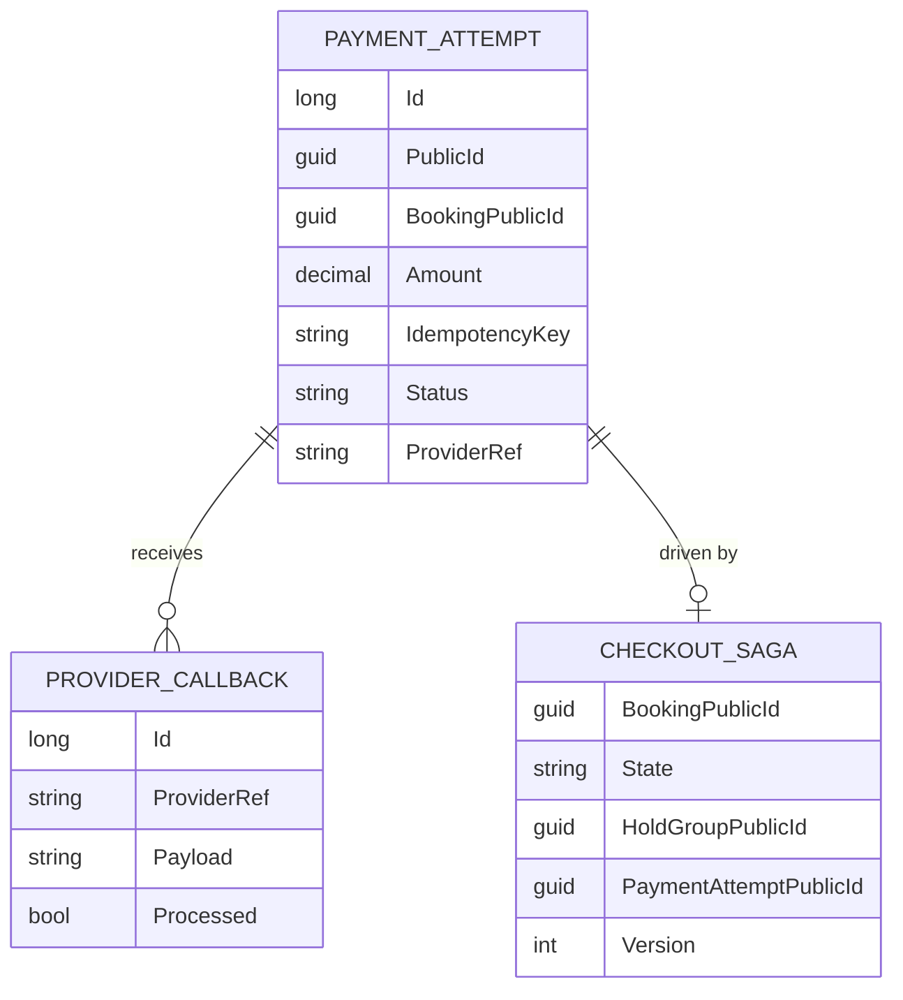
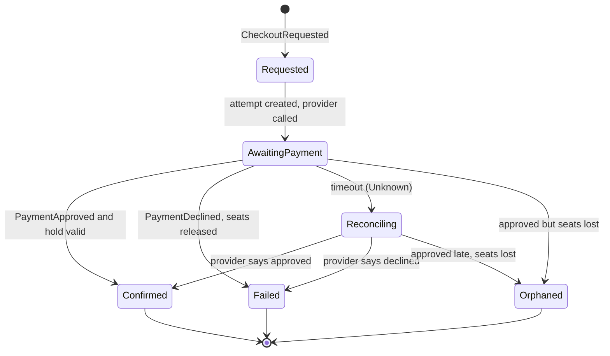
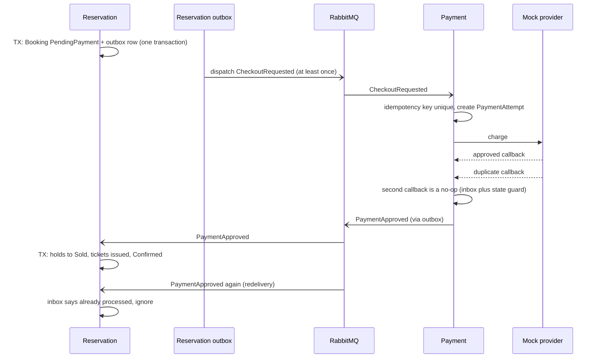
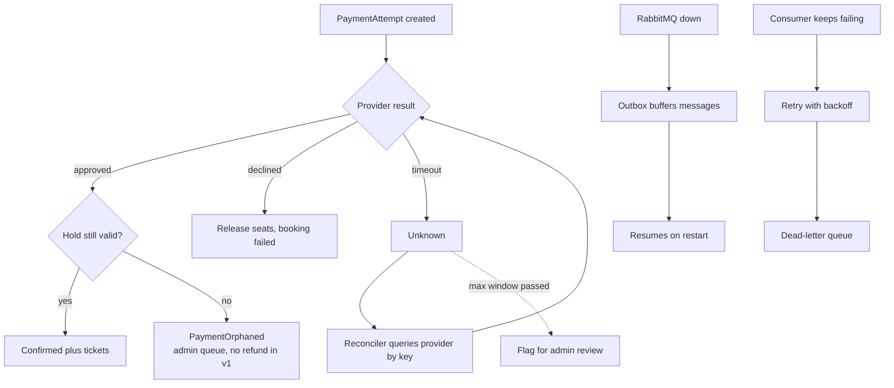

# SPEC-payment

Depends on: reservation.

Planned under T10. Current checkout only uses an in-process Reservation simulation.

## Objective
Take payment for a held booking exactly once and drive the checkout to exactly one confirmed booking, using idempotency, an outbox and a saga. Interview focus: dual writes, at-least-once delivery, timeouts, late success.

## Data model (schema `payment`)
- `PaymentAttempt(Id, PublicId, BookingPublicId, UserId, Amount, Currency, IdempotencyKey, RequestHash, Status, ResponseJson, ProviderRef, CreatedAtUtc, UpdatedAtUtc)` with Status in `Initiated`, `Approved`, `Declined`, `Unknown`, `Reconciled`, `Superseded`. Constraints: `UNIQUE(UserId, IdempotencyKey)`, and a filtered unique index on `BookingPublicId` where Status in (`Initiated`, `Approved`, `Unknown`) so a booking can never have two live or successful attempts.
- `ProviderCallback(Id, ProviderRef, Payload, ReceivedAtUtc, Processed)` for duplicate/out-of-order handling.
- Saga state (Wolverine-managed): `CheckoutSaga(BookingPublicId as saga id, State, HoldGroupPublicId, PaymentAttemptId, Version, ...)`. Tables otherwise follow the id strategy in SPEC.md (`Id bigint` clustered; `PublicId` only on `PaymentAttempt`).
- Wolverine outbox/inbox tables in each publishing/consuming service schema.

## Mock provider
`IPaymentProvider` with an in-process mock plus a callback simulator endpoint (dev profile only, `admin` role via the `payments:ops-read` check plus an environment flag) that can: approve, decline, delay, send duplicate callbacks, send out-of-order callbacks, and time out. The scenario can be selected per request via a test card number convention (for example `4000...0002` declines, `...9995` times out).

## Messages (Contracts)
`CheckoutRequested(bookingPublicId, holdGroupPublicId, amount, userId)`, `PaymentApproved`, `PaymentDeclined`, `PaymentUnknown`, `DuplicateChargeDetected`, `BookingConfirmed`, `BookingExpired`, `BookingPaymentOrphaned`, `SeatReleased` (all versioned, include correlation id and trace context).

## Saga flow
1. Reservation creates `Booking(PendingPayment)` and publishes `CheckoutRequested` through the outbox.
2. Payment creates a `PaymentAttempt` with the idempotency key and calls the provider.
3. Approved: Reservation converts holds to tickets and sets `Confirmed`, publishes `BookingConfirmed`.
4. Declined: seats released, booking `Expired`/failed, `PaymentDeclined` published.
5. Timeout: attempt `Unknown`; a reconciler queries the provider by key and resolves it; the hold is kept until resolved or a maximum reconcile window.
6. Late success after expiry or seat loss: booking `PaymentOrphaned`, `BookingPaymentOrphaned` published (no refund in v1; listed in the admin queue).
7. Duplicate or out-of-order callbacks are no-ops (inbox + state machine guards).

## Double-payment protection (defense in depth)
A customer must never be charged twice for one booking, whether from a double-click, a client retry after a timeout, two browser tabs, a duplicate or replayed broker message, a duplicate provider callback, or a retry after an ambiguous result. Seven layers, each tested:

1. **Client:** the web app generates one `Idempotency-Key` (UUID) per checkout attempt and reuses it for every retry of that attempt; the pay button is disabled while a request is in flight. A new key is created only after a definitive failure (declined) and the user chooses to try again.
2. **API contract:** `POST /payments` requires `Idempotency-Key` (400 if missing). The service stores a SHA-256 `RequestHash` of the canonical request (booking, amount, currency). Same key + same hash: return the stored result (replayed, with an `Idempotent-Replayed: true` header). Same key + different hash: 422 (key reuse with a different payload). Same key while the first request is still running: 409 with `Retry-After` (never start a second charge).
3. **Database:** the attempt row is inserted first (claims the key) inside a transaction using `UNIQUE(UserId, IdempotencyKey)`; the loser of a race hits the unique violation and returns the winner's result. Keys are scoped per user so one user's key cannot collide with or read another's. Keys expire after 24 hours (cleanup job); the filtered unique index below does not expire.
4. **One live attempt per booking:** the filtered unique index (see data model) means a second attempt with a *different* key for the same booking is rejected with 409 while an attempt is `Initiated`, `Approved` or `Unknown`; after a `Declined` result a new attempt is allowed. A booking that is already `Confirmed` rejects any payment.
5. **Provider call:** the key (or the attempt's `PublicId`) is sent to the provider as its own idempotency/merchant reference, so even if our call is retried the provider charges once; after a timeout the reconciler looks the payment up by that reference and never blindly re-charges.
6. **Messaging:** inbox table dedupes by message id; `PaymentApproved` on a booking that is already `Confirmed` is a no-op; saga state transitions are guarded (only valid transitions apply).
7. **Last resort detector:** if a second approval ever arrives for a booking that is already paid (for example a provider-side duplicate), the attempt is marked `Superseded`, a `DuplicateChargeDetected` event is published, and it is listed in the ops queue (`GET /admin/payments/duplicates`) for manual refund handling (automatic refunds are out of scope in v1). A metric and log line are emitted.

## API
- All payment endpoints require authentication; `POST /payments` (`payments:pay`, requires `Idempotency-Key` header; behavior in "Double-payment protection"). The payer must own the booking.
- `POST /payments/callback/{provider}` (simulator only, signed with a shared dev secret from env).
- `GET /admin/payments/orphaned`, `/unknown` and `/duplicates` (`payments:ops-read`).

## Acceptance criteria
1. Same idempotency key sent 10 times concurrently creates exactly one attempt and one provider charge; all 10 responses carry the same result (one original, nine replays or 409s that resolve to it).
1a. Same key with a different amount or booking returns 422 and changes nothing.
1b. Two different keys for the same booking sent concurrently: exactly one attempt proceeds, the other gets 409; the provider mock records exactly one charge.
1c. User B cannot replay or read user A's key or attempt; paying for a booking you do not own returns 404.
1d. Double-click and retry-after-timeout scenarios in the UI (Playwright) produce one charge: the button is disabled in flight and the retry reuses the same key.
1e. Timeout then retry with the same key: the attempt is `Unknown`, the retry does not create a second provider charge, and the reconciler resolves the original.
1f. A forced second approval for an already confirmed booking ends `Superseded`, publishes `DuplicateChargeDetected` and appears in `/admin/payments/duplicates`, with no second ticket set.
1g. Keys older than 24 hours are cleaned up without affecting the one-live-attempt-per-booking rule.
2. Approved, declined, duplicate callback, delayed callback, out-of-order callbacks, timeout then reconcile, and late success each end in the correct final state (one test per outcome, saga unit plus integration).
3. A payment approval yields exactly one confirmed booking and one ticket per seat even when `PaymentApproved` is delivered twice.
4. Stopping RabbitMQ during checkout doesn't lose the request; after restart it completes (outbox).
5. A failing consumer retries with backoff and ends in a dead-letter queue after max attempts.
6. Trace id is continuous from HTTP request through broker to consumer (target verification once messaging/observability are implemented).
7. ADR 5 and ADR 6 written.

## Testing
Saga state-machine unit tests; Testcontainers (SQL Server + RabbitMQ) integration tests; contract tests for message schemas.

## Boundaries
Never: real card data or real provider calls; cross-schema access between Reservation and Payment (messages and HTTP only). Ask first: switching to MassTransit v8 (Wolverine's time-box is set in `platform`).

## Diagrams

### Data model

### Checkout saga states

### Checkout with outbox (happy path and duplicate)

### Failure paths

