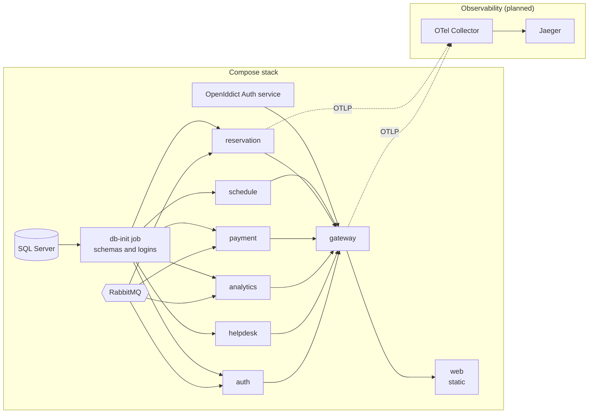
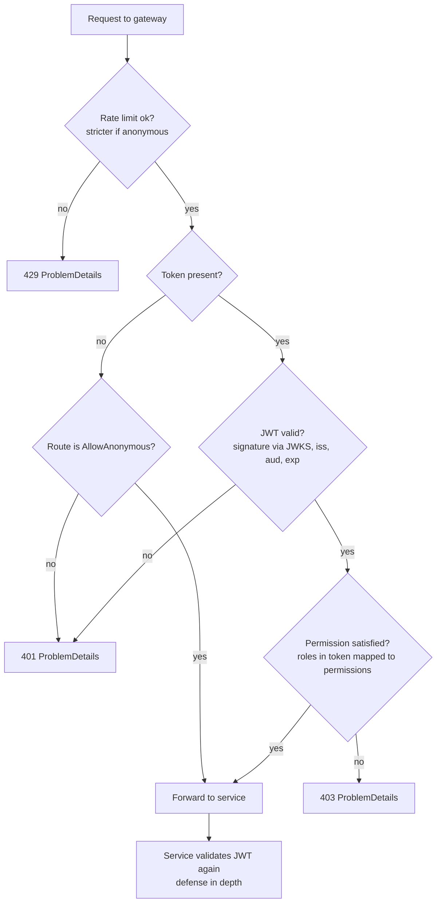
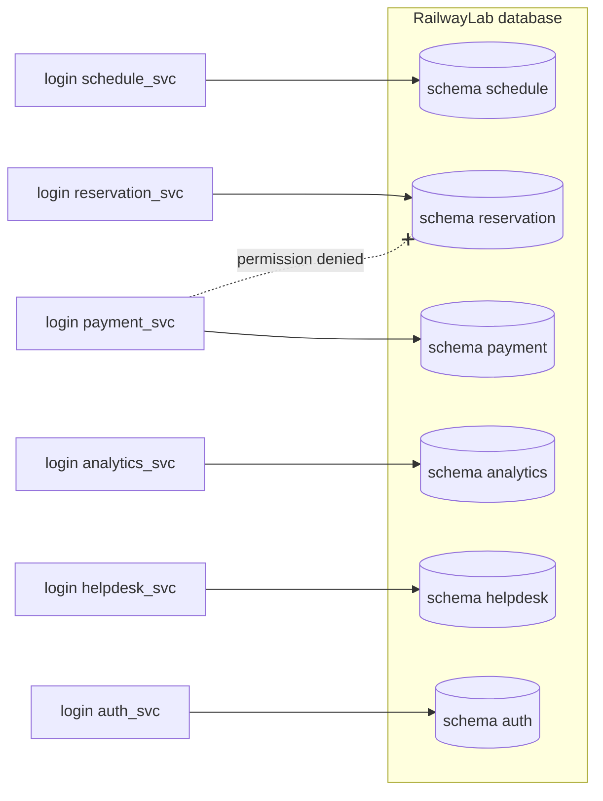

# SPEC-platform

Depends on: none.

Shared defaults, gateway and Compose are implemented. CI, broker and collector/Jaeger requirements below remain target work.

## Objective
Everything every service needs to run, authenticate, be observed and built, so later modules only add features. Learning focus: Docker, Compose, OIDC, OpenTelemetry, CI.

## Scope
- `docker-compose.yml` with no profiles: a plain `docker compose up` starts everything defined so far. Currently that is SQL Server, `db-init`, Auth, Schedule, Reservation, gateway and web; each later task adds its own service (and RabbitMQ, OTel Collector, Jaeger when first needed).
- SQL Server init: one database, schema + SQL login per service (`schedule`, `reservation`, `payment`, `analytics`, `helpdesk`, `auth`), login granted rights only on its own schema. Init via a repeatable script/job.
- OIDC/Auth service wiring in Compose. The identity configuration and token contract are owned by [SPEC-auth.md](SPEC-auth.md).
- YARP gateway: currently routes `/api/auth/*` and `/api/schedule/*`; each service task adds its own `/api/<service>/*` route and cluster (and `/hubs/*` WebSocket pass-through when the first hub exists) (the `/internal/*` paths are never routed), JWT validation on protected routes (anonymous requests are allowed through to endpoints that declare `AllowAnonymous`), basic fixed-window rate limit per IP with a stricter bucket for anonymous traffic.
- `src/Platform` (technical only): service defaults (Serilog, OpenTelemetry tracing+metrics, health endpoints `/health/live` and `/health/ready`, ProblemDetails, JWT bearer setup from the custom Auth service discovery and permission-based authorization (both defined in [SPEC-auth.md](SPEC-auth.md), part A), Scalar/OpenAPI).
- Wolverine defaults in `Platform` (technical only): handler discovery per service, in-process bus (`IMessageBus`) registration, EF Core transaction/outbox integration helper, and logging/trace propagation middleware. Schedule uses directly injected query services; add Wolverine to a service when it needs its transaction, messaging, or outbox capabilities.
- A "default-deny" guard (extended in `auth`): a test that enumerates all endpoints and hub methods and fails if any lacks a permission or an explicit `AllowAnonymous`; `AllowAnonymous` endpoints must also be on a reviewed allowlist in the test (so adding a public endpoint is a conscious change), and must be `GET`/read-only.
- One multi-stage Dockerfile per deployable (build with repo root context, restore layer cached from csproj, slim ASP.NET runtime, non-root, health check).
- GitHub Actions workflow: restore, build, test, build container images. Planned.
- Jaeger + OTel Collector. Planned.

## Acceptance criteria
1. `docker compose up -d --build` (from the project root) on a clean machine gets every container healthy with no manual steps.
2. Each service's SQL login can read/write its own schema and gets permission denied on another schema (integration test).
3. A request without a token to a public read route (stations, search, availability, seat map) returns 200; without a token to a protected route (holds, checkout, bookings, admin) returns 401; with a passenger token to an admin route returns 403 (ProblemDetails body); role and permission details are tested in `auth`.
4. An architecture test fails if any endpoint file references `DbContext` directly, and a sample command invoked via `IMessageBus` runs its handler with a transaction.
5. The endpoint-authorization test fails when a test endpoint is added without a permission or allowlisted `AllowAnonymous`.
6. `/health/live` is 200 whenever the process runs; `/health/ready` is 503 when the database is unreachable.
7. One request produces a single trace id in logs of the gateway and the downstream service (target verification in Jaeger, later spanning the broker and consumer).
8. CI runs on push and fails on test failure; images build.

## Testing
Integration tests with Testcontainers for schema isolation and health; authorization matrix test; manual Jaeger check.

## Boundaries
Always: secrets from environment, `.env.example` with placeholders only. Ask first: changing roles or token lifetimes (owned by `auth`). Never: domain code in `Platform`.

## Risks
Custom OIDC/Auth service is the active path; a minimal ASP.NET Identity fallback remains available only if the Auth service is delayed. Evaluate Wolverine when a service first needs messaging, transactions or an outbox; fallback is plain application-service classes for in-process calls plus MassTransit v8 for messaging (record in ADR 6). SQL Server under emulation (ADR 2, day 1).

## Diagrams

### Container topology and startup order

Arrows mean "must be healthy first" (`depends_on: condition: service_healthy`).

### Request path and the access decision

### Schema isolation (one database, login per service)

