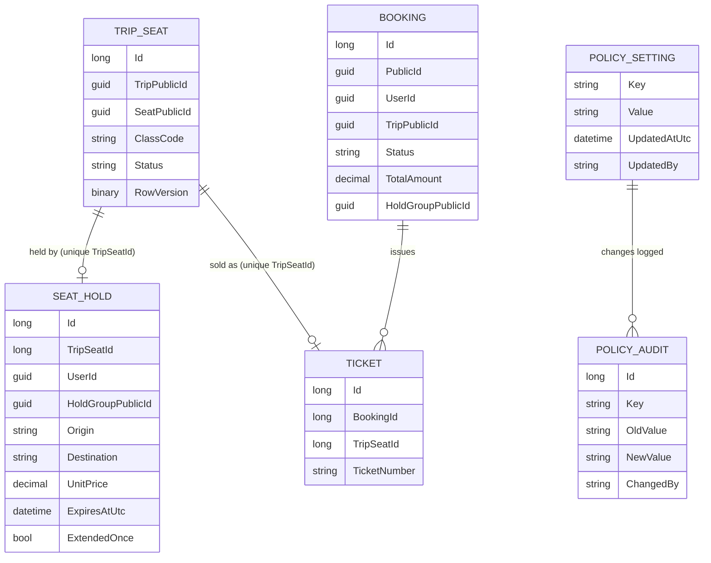
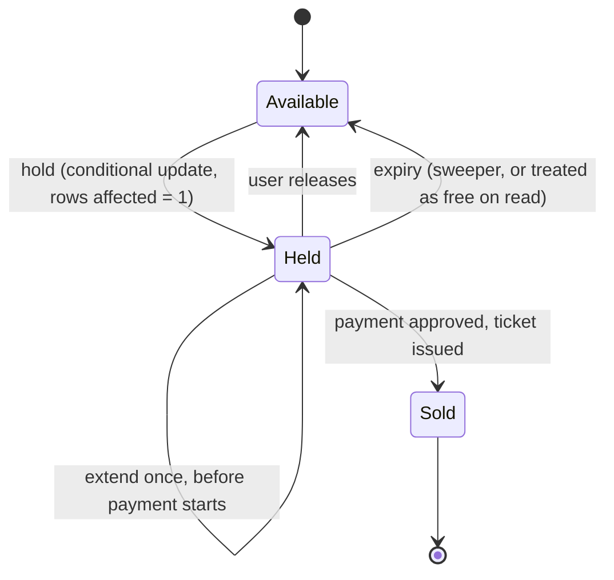
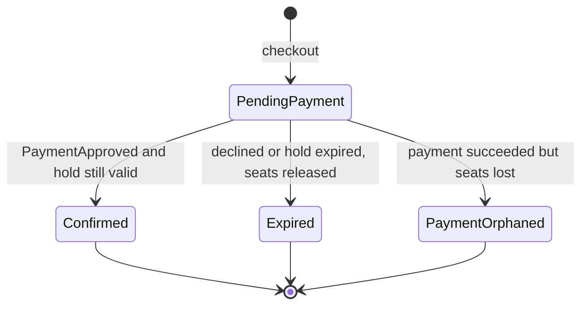
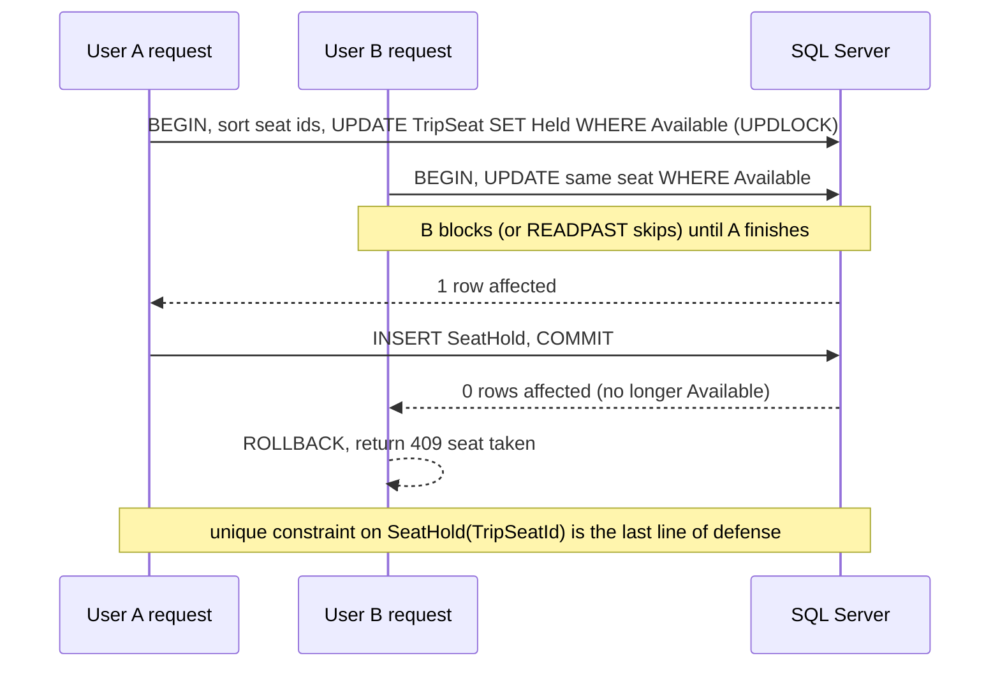
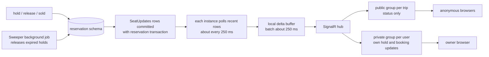

# SPEC-reservation

Depends on: schedule, auth (part A permissions).

## Implementation status
Inventory, availability, seat status, holds, policy updates, quoted checkout and owner/admin booking-read endpoints are implemented. An in-process payment simulation invokes the atomic ticket-issuance transition and does not charge money. The expiry sweeper, SignalR updates, seat selection, hold controls and My bookings pages are present. The migration-backed SQL update stream, independent reader checks and locking comparison have passed SQL integration tests. ADR 3 records measured contention results and their limits. Real passenger browser checks passed quote, hold, extension, simulated checkout and My bookings; a separate anonymous browser observed a hold update in 383 ms in one run. T9 acceptance is complete; the polling stream remains a best-effort lab-scale invalidation mechanism, and T7 global logout acceptance is still open. The Payment service is a later task. The remaining sections describe the complete target.

## Objective
Sell each seat at most once under concurrency. Own seat state, holds, bookings, policy and real-time seat updates in one service and one database transaction boundary.

## Data model (schema `reservation`)
- `PolicySetting(Key PK, Value, UpdatedAtUtc, UpdatedBy)` with `MaxSeatsPerUserPerTrip` (default 4) and `HoldMinutes` (default 8). Read at decision time (short cache with explicit invalidation on update). `PolicyAudit(Id, Key, OldValue, NewValue, ChangedBy, ChangedAtUtc)`.
- `TripSeat(Id, TripPublicId, SeatPublicId, ClassCode, Status, RowVersion)` with UNIQUE(TripPublicId, SeatPublicId) and Status in `Available`, `Held`, `Sold`. `TripPublicId` and `SeatPublicId` reference the Schedule service's ids (no foreign key across schemas). Candidate tuning change later: cluster by trip.
- `SeatHold(Id, TripSeatId, UserId, HoldGroupPublicId, Origin, Destination, UnitPrice, ExpiresAtUtc, ExtendedOnce)` with FK to `TripSeat(Id)` and UNIQUE(TripSeatId) so a seat has at most one hold row. `UnitPrice` is the server-calculated segment fare captured at hold time. `HoldGroupPublicId` is a plain GUID column grouping the seats of one hold (not a table).
- `Booking(Id, PublicId, UserId, TripPublicId, Status, TotalAmount, CreatedAtUtc, HoldGroupPublicId)` with Status in `PendingPayment`, `Confirmed`, `Expired`, `PaymentOrphaned`.
- `Ticket(Id, BookingId, TripSeatId, TicketNumber, IssuedAtUtc)` with FK to `Booking(Id)` and `TripSeat(Id)`, UNIQUE(TripSeatId) and a unique human-readable `TicketNumber`.
- Outbox/inbox tables created by Wolverine (from `payment` phase on).

## Rules
1. A seat is sold at most once, enforced by the database: conditional update (`Status = Available` or expired hold) checked by rows affected, plus unique constraints as last defense. Cache and SignalR are never authoritative.
2. Hold: user selects up to the policy cap of seats on a trip; all-or-nothing; locks acquired in sorted `TripSeat.Id` order to avoid deadlocks; hold lasts `HoldMinutes`.
3. A user may have at most `MaxSeatsPerUserPerTrip` seats across active holds and confirmed tickets on a trip. One active hold group per user per trip.
4. A hold may be extended once, only before payment starts.
5. An expired hold counts as available even if the sweeper hasn't run (correctness does not depend on the sweeper). A background sweeper releases expired holds and emits seat-release deltas; safe to run on multiple instances (idempotent, `UPDLOCK, READPAST`).
6. Confirming payment (from `payment`) converts holds to `Sold` + `Ticket` rows in one transaction; if the hold expired and the seat is gone, the booking becomes `PaymentOrphaned`.
7. Locking strategy (pessimistic `UPDLOCK` vs optimistic RowVersion) is chosen with measurements and recorded in ADR 3.

## API (permissions per endpoint, see [SPEC-auth.md](SPEC-auth.md))
- **Public (anonymous):** `GET /trips/{tripPublicId}/availability` (JSON array of `{ "classCode", "total", "available", "held", "sold" }` objects, one per class), `GET /trips/{tripPublicId}/seats` (seat map with status per seat: available/held/sold; no user info), and `GET /seat-limit` (the configured maximum selection size). When a valid token is present, the seat map additionally marks the caller's own holds (`mine`). The server also checks the caller's existing tickets when enforcing the cap.
- `POST /trips/{tripPublicId}/holds` body `{seatPublicIds, origin, destination}` (`seats:hold`); 200, 409 (seat taken), 422 (cap exceeded). Reservation obtains the segment fare from Schedule and stores it with the hold; clients never supply a price. The response includes the held seats, journey, expiry and server-calculated total.
- `GET /holds/{holdGroupPublicId}` (`seats:hold`, owner only) returns the current hold and quote for confirmation.
- `POST /holds/{holdGroupPublicId}/extend`, `DELETE /holds/{holdGroupPublicId}` (`seats:hold`, own holds only).
- `POST /holds/{holdGroupPublicId}/checkout` (`seats:hold`) creates `Booking(PendingPayment)` and calls Payment (sync in this module with a stub; async saga arrives in `payment`). Optional body field `onBehalfOf: { passengerName }` requires `bookings:create-on-behalf` (station-agent): the booking stores `PassengerName` and `BookedByUserId`, and the cap counts against the agent's own user id as usual.
- `GET /bookings`, `GET /bookings/{bookingPublicId}` (`bookings:read-own`; ownership enforced: another user's booking returns 404).
- `GET /admin/bookings?search=`, `GET /admin/bookings/{bookingPublicId}` (`bookings:read-any`).
- `GET /admin/policy` (`policy:read`), `PUT /admin/policy/{key}` (`policy:write`; audited).
- SignalR hub `/hubs/seats`: anyone (anonymous) may join the public group for a trip and receive batched seat deltas (about every 250 ms, status only); authenticated users additionally receive their own hold/booking status updates in a per-user group. Joining another user's group is impossible by construction (the group name comes from the token, not the client).

## UI
Seat map (coaches, rows, seats, colors for available/held/mine/sold) visible to anonymous users; selecting a seat as an anonymous user prompts login and returns to the same trip with the selection kept; seat selection up to the cap, hold countdown timer, extend and release buttons, checkout button, live updates from SignalR with reconnect and refetch, My bookings page (login required).

## Acceptance criteria
1. **Concurrency test:** N (at least 50) parallel hold requests for the same seat produce exactly one success and N-1 conflicts; no duplicate `SeatHold`/`Ticket` rows.
2. Multi-seat requests with overlapping seats from two users never deadlock indefinitely and never produce partial holds.
3. Requesting more seats than the cap (counting existing holds and tickets) returns 422; changing the cap in the policy table changes enforcement without redeploy.
4. A seat whose hold has expired can be held by another user before the sweeper runs; after the sweeper runs it is released and a delta is broadcast.
5. Extending a hold works once; the second extension and extension after checkout started are rejected.
6. A user cannot read another user's booking; a passenger token gets 403 on `/admin/*` endpoints; `operations` can read policy but gets 403 on `PUT /admin/policy/{key}`; `sam` (station-agent) can check out with `onBehalfOf` and read any booking, while `alice` gets 403 when she sends `onBehalfOf`.
7. Anonymous `GET /trips/{tripPublicId}/availability` and `/seats` return 200 with correct counts and no user ids; anonymous `POST /holds`, checkout and `GET /bookings` return 401; an anonymous SignalR client receives seat deltas but cannot receive any user's booking updates.
8. Two browser sessions see each other's holds on the seat map within about 1 second.
9. Policy changes are written to `PolicyAudit` with user and timestamps.
10. ADR 3 contains measured throughput and conflict rate for at least two strategies.

## Testing
Unit: cap and expiry rules. Integration (Testcontainers): concurrency, deadlock, sweeper, expiry. Hub test with two clients. Angular: seat-map component, hold timer.

## Boundaries
Always: transactions short; sort lock order. Ask first: moving to per-leg inventory (optional extension after criteria pass). Never: trust client-sent prices or seat classes; read other schemas.

## Diagrams

### Data model

A hold group is only the shared `HoldGroupPublicId` value on `SeatHold` rows and the `Booking`; it is not a table.

### Seat lifecycle

### Booking lifecycle

### Concurrent hold (the interview centerpiece)

### Real-time seat updates and the sweeper

