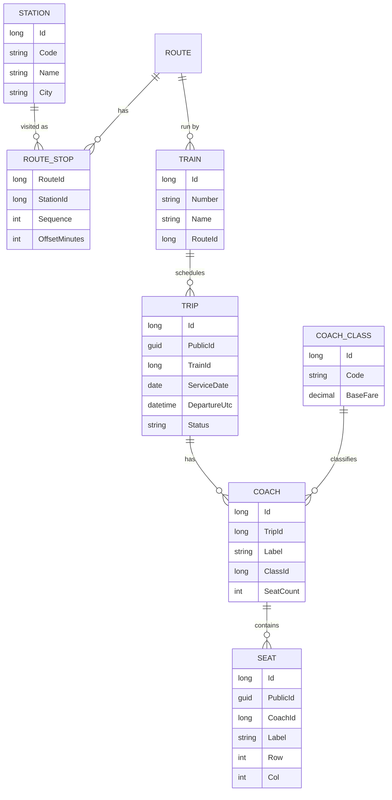
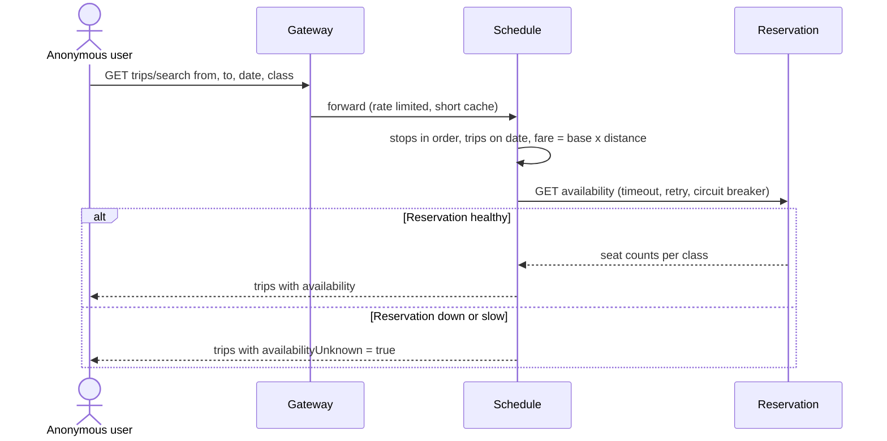

# SPEC-schedule

Depends on: platform, web-shell.

T8 acceptance passed. This file retains the Schedule contract and verification criteria.

## Objective
Static railway data (stations, trains, trips, coach layouts) with a search API and UI. Read-only after seeding; it exists so Reservation has trips and seats to sell.

## Data model (schema `schedule`)
All tables have `Id bigint IDENTITY` (see the id strategy in SPEC.md). Only `Trip` and `Seat` are referenced by other services, so only they have `PublicId`.
- `Station(Id, Code, Name, City)`
- `Route(Id, Name)` and `RouteStop(RouteId, StationId, Sequence, OffsetMinutes)`
- `Train(Id, Number, Name, RouteId)`
- `Trip(Id, PublicId, TrainId, ServiceDate, DepartureUtc, ArrivalUtc, Status)` (Status: Scheduled, Departed)
- `CoachClass(Id, Code, Name, BaseFare)` (e.g. Economy, Business)
- `Coach(Id, TripId (FK to Trip.Id), Label, ClassId, SeatCount)` and `Seat(Id, PublicId, CoachId, Label, Row, Column)` (per trip so Reservation can mirror them)
- Seed: about 12 stations, 4 routes, 6 trains, trips for the next 14 days, 2 classes, about 8 coaches per trip x 40 seats. Deterministic seeder with stable trip and seat IDs.

## Service structure

Endpoints call scoped services in `src/Services/Schedule/Services` (`Schedule.Services`) directly. These services read through `ScheduleDbContext`; Schedule does not use an in-process message bus or an outbox. Search calls the Reservation availability client after reading the schedule. When Reservation is unavailable, availability is unknown.

## API (read-only; the Schedule service has no write endpoints)
- `GET /stations?query=`
- `GET /trips/search?from=&to=&date=&class=` returns trips with times, fare per class (base fare x distance factor), and seat counts per class from Reservation (HTTP call with Polly timeout/retry/circuit breaker; if Booking is unavailable, return trips without availability and a flag).
- `GET /trips/{tripPublicId}` and `GET /trips/{tripPublicId}/layout` (coaches and seats).
- `GET /internal/trips/{tripPublicId}/fare?from=&to=&class=` returns the server-calculated journey fare for Reservation. The gateway blocks `/internal` paths; this service-to-service endpoint is not exposed through it.
- Publishes nothing in v1; Reservation pulls the layout on demand and persists a trip inventory snapshot in its own database.

## UI
Search page (from, to, date, class) listing trips with price and availability; select a trip to go to seat selection (implemented in `reservation`).

## Acceptance criteria
1. Fresh stack contains the seeded data; reseeding is idempotent.
2. Search returns only trips on the date where from precedes to on the route sequence.
3. Search by class returns the right fare.
4. With Reservation stopped, search still returns 200 with `availabilityUnknown = true`.
5. Public endpoints are reachable without a token, are GET-only, and are on the platform's public-endpoint allowlist; none returns personal data. The fare endpoint is restricted from gateway access.
6. Search on seeded data returns in under 200 ms locally (measured, not tuned).

## Testing
Unit: route direction logic and fare calculation. Integration: search against Testcontainers SQL Server. Angular: search form component test.

## Boundaries
Never: write endpoints that mutate schedule data in v1.

## Diagrams

### Data model

### Public search with graceful degradation

