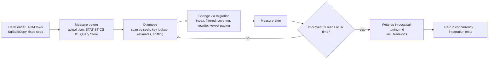

# SPEC-sql-tuning

Depends on: reservation, payment.

Planned measured tuning work. The existing locking experiment is a contention demonstration, not this tuning deliverable.

## Objective
Show I can find and fix real SQL Server performance problems with evidence. Produce a write-up with at least three before/after improvements.

## Scope
- `tools/DataLoader` console app using `SqlBulkCopy` that loads about 1 to 3 million rows across `TripSeat`, `Booking`, `Ticket`, `PaymentAttempt` (schema-appropriate, deterministic with a seed). Run against a database copy, not by code in services.
- Start by deliberately keeping the first-version indexes minimal; then capture the slow queries.
- Candidate targets: seat availability query for a trip, search availability counts by class and date, "my bookings" list, sweeper scan of expired holds, analytics range queries, payments by status.
- Tools: actual execution plans, `SET STATISTICS IO, TIME ON`, `sys.dm_exec_query_stats`, Query Store, missing-index DMVs.
- **Id strategy experiment (feeds ADR 2):** build the same `TripSeat`/`Booking` tables two ways on the same loaded data: (A) the chosen hybrid, `Id bigint IDENTITY` clustered plus a unique nonclustered index on `PublicId`; (B) a sequential GUID as the clustered primary key (EF Core's SQL Server sequential generator). Optionally (C) a random `NEWID()` clustered key as the bad baseline. Compare: table and index size (`sys.dm_db_partition_stats`), page count and fragmentation after loading and after 100k random-order inserts (`sys.dm_db_index_physical_stats`), log bytes generated per 100k inserts, logical reads and latency for a lookup by `PublicId` (A costs two seeks, B one), for a range or join through a nonclustered index (B's wider locator), and the 50-parallel-claim seat test throughput. Record numbers and the decision in `docs/sql-tuning.md` and ADR 2; if B is not clearly worse, say so and explain why the hybrid was still kept (non-guessable public ids, narrow internal key) or switch.
- Output: `docs/sql-tuning.md` with, per case: query, problem, before plan and numbers (logical reads, time), change (index, filtered index, covering/included columns, keyset pagination, rewrite, statistics, or parameter sniffing fix), after plan and numbers, and trade-offs (write cost, size).

## Acceptance criteria
0. The id strategy experiment is done for at least A and B with the metrics above in a table, and the ADR 2 conclusion cites it.
1. Loader creates the target row counts in under 10 minutes locally and is repeatable.
2. At least 3 documented improvements, each with before and after plan evidence and measured logical reads dropping by at least 5x, or latency by at least 3x.
3. At least one case demonstrates a trade-off (for example write overhead of an index) and one demonstrates reading a plan for a key lookup or scan versus seek.
4. Concurrency test from `reservation` still passes after index changes.
5. Index changes are applied through migrations, not manual DDL.

## Testing
Re-run the reservation concurrency and the integration test suite after changes.

## Boundaries
Never: tune by guesswork without a before measurement; load data into the services' production-like schemas without a reset path (`down -v`). Ask first: using Dapper or compiled queries (only with measurement; ADR note).

## Risks
Emulated SQL Server on Apple Silicon is slower; if the load is too slow, reduce to 1M rows. The conclusions are relative (before versus after), which remain valid.

## Diagrams

### Tuning loop

