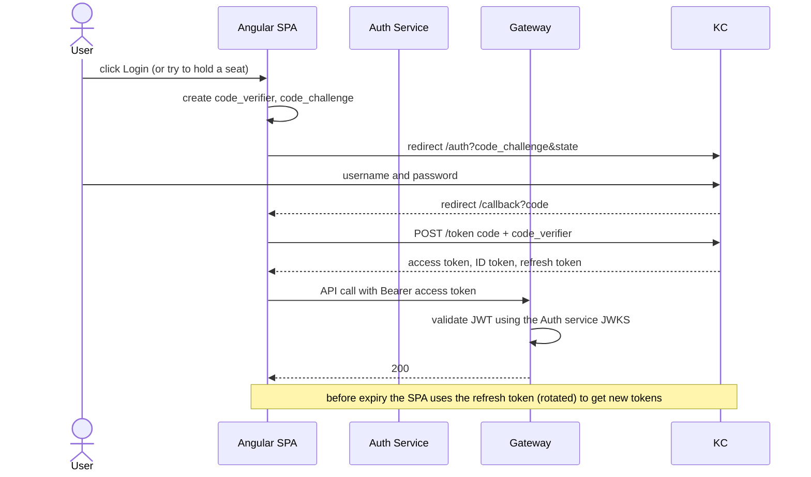
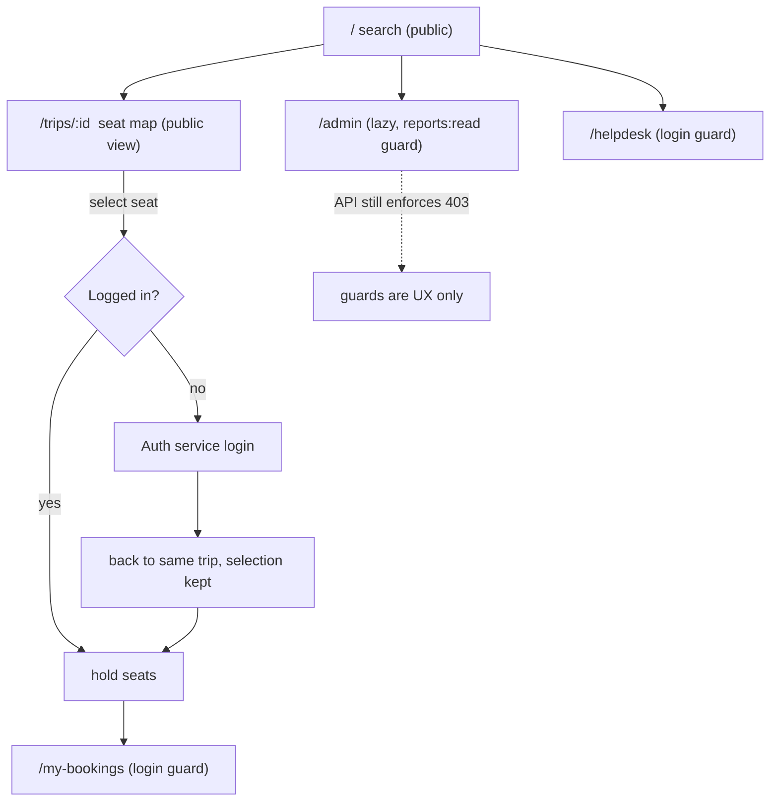

# SPEC-web-shell

Depends on: platform, auth (OpenIddict `web` client from part A).

The Angular passenger flow is implemented. T7 refresh/global logout acceptance and future operational screens remain open.

## Objective
The Angular application skeleton with real OIDC login, used by every later UI feature. Angular is new to me, so keep it plain and understandable.

## Scope
- Angular (current stable) in `src/Web`, standalone components, signals, built-in router and HttpClient, plain CSS, no UI library, no SSR.
- Login via `angular-oauth2-oidc`: Authorization Code + PKCE against the custom OpenIddict Auth service, silent refresh, logout.
- `AuthService` (signals: `isLoggedIn`, `user`, `roles`, `permissions`), HTTP interceptor attaching the access token to `/api/*` only, route guards for login and by permission (`permissionGuard('reports:read')`). Currently permissions come from a static map mirroring the seed file; a remote permission snapshot is planned in Auth part B. The interceptor attaches a token only when the user is logged in, so anonymous browsing works; calls that need auth trigger the login redirect (guard or 401 handler) and return to the original URL afterwards.
- Layout: header with nav (Search, My bookings, Admin if the user has `reports:read`, Access if `auth:read`, Helpdesk), user menu, light/dark toggle, error toast for ProblemDetails responses.
- Routes: `/` (search, public), `/trips/:id` (seat map, public to view; login needed to hold), `/my-bookings` (login guard), `/admin` (lazy, `reports:read` guard), `/admin/auth` (lazy, `auth:read` guard, built in `auth` part B), `/helpdesk` (unavailable-state screen until T12), `/callback`.
- Static container: own Dockerfile (nginx or similar), served in Compose.

## Acceptance criteria
1. A logged-out visitor can use the search page and view a trip's seat map and availability without logging in.
2. Visiting the app logged out and clicking Login redirects to the Auth service and returns signed in as `alice` with her roles shown.
3. A protected call through the gateway succeeds with the token and the interceptor adds no token to non-API URLs.
4. `/admin` is not reachable as `alice` (redirect to a "forbidden" page); reachable as `admin` and `olivia`. The API still returns 403 independently (guards are UX only).
5. Token refresh works without a visible logout; logout ends the current OIDC session.
6. ProblemDetails errors from the API show a readable toast.
7. `npm run build` passes with a bundle budget set (initial bundle under 500 kB gzipped is not required, just a configured budget).

## Testing
Unit tests for `AuthService` and guards; manual PKCE check; one Playwright login smoke test (later E2E).

## Boundaries
Ask first: adding any npm UI dependency beyond Chart.js. Never: store tokens in localStorage if the library default allows memory/session storage; document the choice.

## Diagrams

### Login: Authorization Code + PKCE

### Routes and guards

